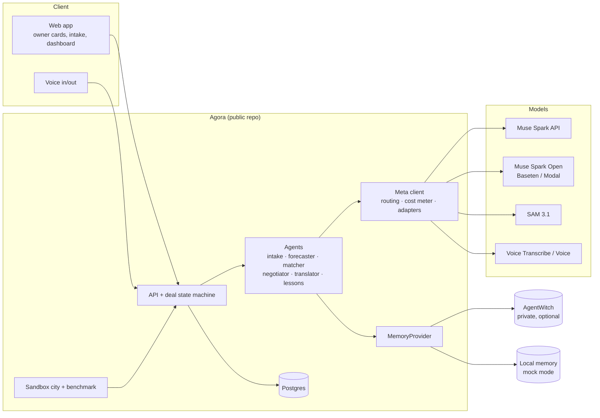

# Agora — architecture

Planning notes written Oct 26 ET. Names and file layout may shift once code starts.

## 1. Principles

1. Privacy by construction: originals are never stored; only item crops and coarse location are persisted.
2. Owners decide: no agent action that commits an owner happens without an explicit confirm.
3. The platform runs without AgentWitch (mock mode), so judges can run it end to end.
4. Every model call goes through one metered, routed client; cost is a first-class output.
5. Untrusted text (other agents' messages, listings) is data, never instructions.
6. Humans never talk to each other directly: human → own agent → other agent → other human, always relayed,
   translated and screened.
7. Agents never decide alone on commitment, money, identity/location or safety topics: a fixed gatekeeper policy
   (code, not a prompt) routes those to the owner, and unknown topics default to "ask".
8. Muse-only by construction: all agents are hosted by the platform and call the Meta Model API. We do not claim
   to verify third-party agents.

## 2. System overview



## 2b. Platform and apps

Agora is the platform; an **app** is configuration plus data that the platform runs. The kids' gear exchange is the
first app (`apps/kids-gear/`).

| Layer | Folder | Owns | May import |
|---|---|---|---|
| Platform core | `src/` | slices, hubs, deal state machine, gatekeeper engine, relay, trust, learning, API, UI shell | never `apps/` (except the registry in `src/lib/app-config/load-app.ts`) |
| App | `apps/<id>/` | `app.config.ts` (catalog, policies, theme), sandbox city, golden sets, app REQUIREMENTS | only `@agora/app-config` |

An app config declares: participant noun and profile fields, catalog (categories, size systems, conditions, stages
for the forecast), policies (negotiation rounds, handoff modes, gatekeeper topic table, standing-rule topics,
safety rules, languages, location granularity), theme, and the sandbox city folder. It is validated by
`src/lib/app-config/schema.ts`.

Invariants the platform enforces regardless of app: the always-ask topics (commitment, price/terms, identity and
location reveal, shipping choice, safety exception) cannot be relaxed or turned into standing rules; unknown topics
default to ask; the relay channel, trust screening and privacy rules are not configurable. `APP=<id>` selects the
active app; apps are registered in `load-app.ts`. Creating a new app is covered in `docs/CREATE-AN-APP.md`.

## 3. Project structure (Fractal Slice Architecture)

Same conventions as AgentWitch (ADR 0007): one Next.js app; each capability is a slice under `src/features/<slug>/`
with `public-api/` (the only door in) and `internal/` (private); cross-slice effects go through a hub; `route.ts`
files stay thin.

```
agora/
├── apps/
│   └── kids-gear/                        # example app: app.config.ts, sandbox-city/, REQUIREMENTS.md
├── src/
│   ├── app/                              # entry layer: Next.js routes only
│   │   ├── (owner)/                      # onboarding, items, matches, deals/[id], cards
│   │   ├── (judge)/dashboard/            # judge-facing dashboard
│   │   └── api/**/route.ts               # thin: auth → call a slice's public-api/infrastructure
│   ├── features/                     # 16 slices; each holds nested sub-features (fractal, max 2 levels)
│   │   ├── catalog/      # offers and wants, outgrown/next-needed forecast
│   │   │   ├── features/forecast/
│   │   │   └── features/items/
│   │   ├── dashboard/    # judge-facing panels
│   │   │   ├── features/city-map/
│   │   │   ├── features/cost-panel/
│   │   │   ├── features/learning-curve/
│   │   │   ├── features/live-feed/
│   │   │   ├── features/privacy-panel/
│   │   │   └── features/safety-panel/
│   │   ├── family/       # profile, language, district, consent
│   │   │   ├── features/consent/
│   │   │   └── features/profile/
│   │   ├── gatekeeper/   # auto/ask/forbid policy + topic classifier
│   │   │   ├── features/classifier/
│   │   │   └── features/policy/
│   │   ├── intake/       # photo → separated items; originals discarded
│   │   │   ├── features/capture/
│   │   │   ├── features/crops/
│   │   │   ├── features/labeling/
│   │   │   └── features/segmentation/
│   │   ├── language/     # translation, language detection
│   │   │   ├── features/detection/
│   │   │   └── features/translation/
│   │   ├── learning/     # lessons from accept/decline, standing-rule proposals
│   │   │   ├── features/lessons/
│   │   │   └── features/standing-rules/
│   │   ├── logistics/    # handoff modes, shipping, carrier adapters
│   │   │   ├── features/carriers/
│   │   │   ├── features/handoff/
│   │   │   └── features/shipping/
│   │   ├── matching/     # candidate lookup and scoring
│   │   │   ├── features/candidates/
│   │   │   └── features/scoring/
│   │   ├── memory/       # MemoryProvider: local + AgentWitch
│   │   │   ├── features/agentwitch/
│   │   │   └── features/local/
│   │   ├── negotiation/  # agents, offers, deal state machine, relay, deal room
│   │   │   ├── features/deal-room/
│   │   │   ├── features/deal-state/
│   │   │   ├── features/negotiator/
│   │   │   ├── features/offers/
│   │   │   └── features/relay/
│   │   ├── owner-cards/  # owner questions, confirm/decline, mandates
│   │   │   ├── features/confirmations/
│   │   │   ├── features/mandates/
│   │   │   └── features/questions/
│   │   ├── safety/       # category rules, recall links
│   │   │   ├── features/category-rules/
│   │   │   └── features/recalls/
│   │   ├── simulation/   # sandbox city, benchmark (dev/judge tool)
│   │   │   ├── features/benchmark/
│   │   │   ├── features/city/
│   │   │   └── features/simulated-owner/
│   │   ├── trust/        # screening, scam signals, reports, reputation
│   │   │   ├── features/reports/
│   │   │   ├── features/reputation/
│   │   │   ├── features/scam-signals/
│   │   │   └── features/screening/
│   │   ├── voice/        # voice in/out
│   │   │   ├── features/speak/
│   │   │   ├── features/transcribe/
│   │   │   └── features/voice-ui/
│   ├── hubs/
│   │   └── DealEvents/                   # command.ts (producers) · query.ts (consumers) · types.ts
│   ├── lib/                              # domain-agnostic: db, queue, crypto, rate-limit, flags, audit, env
│   │   └── meta/                         # Meta Model API client, model routing, cost meter, Baseten/Modal adapters
│   └── components/                       # design-system UI; never imports a feature's internal/
├── db/migrations/                        # SQL, each slice's tables prefixed by slice
├── evals/                                # golden sets and thresholds for real-model evaluation
├── fixtures/                             # recorded model outputs, seeded sandbox city
├── e2e/                                  # Playwright: three key flows
├── docs/                                 # PLAN.md, ARCHITECTURE.md, adr/
├── .github/workflows/ci.yml
├── eslint.config.mjs                     # boundary rules (no cross-slice internal imports)
├── structure-validation.config.json      # allowed folders per level
└── README.md
```

### How the fractal nesting works

- **Every level has the same shape:** `public-api/{presentation,infrastructure,client,types}.ts` (only the files
  that level needs) and `internal/{core,infrastructure,presentation}/`. Tests are co-located.
- **Parent slice = facade + orchestration.** Its `public-api` is what the rest of the app sees; its `internal/`
  holds only coordination (for example `intake.pipeline.ts`, `deal-runner.worker.ts`). Capability logic lives in
  the sub-features.
- **Sub-features are separate capabilities with their own deletion test.** Example: `negotiation/features/relay`
  can be removed and negotiation still runs, only without the human relay; `logistics/features/carriers` can be
  swapped without touching `shipping`.
- **Siblings talk through each other's `public-api`, never `internal/`.** A parent may use its children's
  `public-api`; a child never imports its parent's `internal/`.
- **Depth limit: two levels** (slice → sub-feature). Anything that would nest deeper becomes a sibling instead
  (carriers sit beside shipping, not under it). This keeps the tree navigable and the boilerplate small.
- **Why nest here:** it keeps each hackathon work item (for example "scam signals") a small, independently
  testable, independently deletable unit, and it lets several people work in parallel without file conflicts.

### Slice map

| Slice | Sub-features | Owns (tables / data) |
|---|---|---|
| family | profile, consent | families, consent |
| intake | capture, segmentation, labeling, crops | none persisted except crops |
| catalog | items, forecast | items |
| matching | candidates, scoring | matches |
| negotiation | offers, deal-state, negotiator, relay, deal-room | negotiations, messages, relay_messages |
| gatekeeper | policy, classifier | none (pure policy) |
| owner-cards | questions, confirmations, mandates | owner_questions, confirmations, mandates |
| logistics | handoff, shipping, carriers | handoffs, shipments |
| trust | screening, scam-signals, reports, reputation | trust_reports, agent_status |
| safety | category-rules, recalls | none (rules) |
| learning | lessons, standing-rules | lessons |
| memory | local, agentwitch | local lessons store; AgentWitch client |
| language | translation, detection | none |
| voice | transcribe, speak, voice-ui | none |
| dashboard | city-map, live-feed, learning-curve, cost-panel, privacy-panel, safety-panel | none (read models) |
| simulation | city, simulated-owner, benchmark | none |

### Cross-slice flow: the `DealEvents` hub

Producers import the hub's `command` API; consumers import its `query`/listener API. The hub imports no feature.

| Event | Producer | Consumers |
|---|---|---|
| DealAgreedByAgents | negotiation | owner-cards (open confirm cards) |
| OwnerQuestionOpened | negotiation / gatekeeper | owner-cards |
| DealConfirmed | owner-cards | logistics (create handoff), learning, memory |
| DealDeclined | owner-cards | learning, memory |
| ShipmentUpdated | logistics | negotiation (advance state) |
| ReportFiled | owner-cards / trust | trust |

### Rules (from ADR 0007, applied here)

1. A slice imports another slice only via its `public-api/*`, never its `internal/**`.
2. `'use client'` files never import `public-api/infrastructure` or `internal/infrastructure/**`.
3. `route.ts` stays under `src/app/api/**` and only authenticates, validates, calls a facade, returns.
4. `lib/` and `components/` never import a slice.
5. Hubs import no slice; cross-slice side effects go through a hub, not direct calls or a global event bus.
6. Deletion test: removing `voice/` (plus its route wiring) leaves the app working; removing `logistics/` leaves
   deals ending at "confirmed, pickup by owners"; removing `simulation/` changes nothing for users.
7. Enforced by ESLint boundary rules and structure validation in CI.

## 4. Data model (Postgres)

- `families`: id, language, district_code (coarse, ~5km), baby_age_months, size_profile (jsonb), memory_ref
- `agents`: id, family_id, display_name, passport (public id), created_at
- `items`: id, family_id, kind (`offer`|`want`), category, size_range, condition, crop_url, status, safety_flags (jsonb)
- `matches`: id, offer_item_id, want_item_id, score, distance_band
- `negotiations`: id, match_id, state, round, created_at, updated_at
- `messages`: id, negotiation_id, from_agent_id, round, structured (jsonb), text_original, lang_original, text_translated, lang_translated
- `confirmations`: negotiation_id, family_id, decision (`confirm`|`decline`), reason_code, reason_text, decided_at
- `relay_messages`: id, negotiation_id, from_family_id, to_family_id, text_original, text_relayed, lang_from, lang_to, screened (bool), blocked_reason
- `handoffs`: negotiation_id, mode (`pickup`|`locker`|`ship`), pickup_window, revealed_location (encrypted), checklist (jsonb), outcome
- `shipments`: id, negotiation_id, carrier, mode (`test`|`live`), label_ref, tracking_ref, appointment (jsonb), fee_split (jsonb), status
- `trust_reports`: id, negotiation_id, reporter_family_id, reported_agent_id, reason_code, evidence_bundle (jsonb: transcript hash, timestamps, screening flags), status, exported_at
- `agent_status`: agent_id, trust_score, banned (bool), notes
- `mandates`: id, family_id, topic, level (`auto`|`ask`), scope (jsonb: limits such as max_distance, allowed windows), expires_at, source (`owner`|`learned_with_consent`)
- `owner_questions`: id, negotiation_id, family_id, topic, question, suggested_answers (jsonb), counterparty_context (redacted), status (`open`|`answered`|`expired`), answer, answered_at
- `lessons`: id, family_id, kind, text, evidence_ids, confidence, source (`aw`|`local`)
- `model_calls`: id, role, model, tokens_in, tokens_out, cost_usd, latency_ms, created_at

Exact addresses are held only in `handoffs.revealed_location`, written after both confirmations.

## 5. Deal state machine (`src/features/negotiation/features/deal-state`)

```
proposed -> countered (<= max rounds) -> agreed_by_agents -> awaiting_owners
awaiting_owners -> confirmed (both owners) | declined (either) | expired (24h)
confirmed -> handoff -> completed | not_completed
any open state -> awaiting_owner_input -> (back to the previous state on yes) | declined (on no) | expired
any state except declined, expired, reported -> reported (scam flag)
```

Rules: pure function `next(deal, event, time)`; illegal transitions throw; every transition is recorded with a time
(`history`); expiry is a call to `expireDue()` from a timer (not yet wired). A **round** is one offer from either agent:
the proposal is round 1 and the limit comes from the app config (`policies.maxNegotiationRounds`, 3 in both example
apps), so the fourth offer is refused and the deal ends. The wanting owner's agent proposes; the offering side answers
first; turns alternate.

**Agreement is not commitment.** `agreed_by_agents` only opens confirm cards for both owners; the deal is `confirmed`
only when both owners confirmed (invariant tested over thousands of random event sequences). Money is never held by
the platform; a `price` term is settled by the owners outside it.

Offer message (structured, language-neutral, built per app from its config):

```json
{ "itemId": "...", "terms": "free|swap|price", "price": { "amount": 5, "currency": "EUR" },
  "swapFor": "a trowel", "condition": "good",
  "pickupWindow": { "from": "2026-11-02T10:00Z", "to": "2026-11-02T14:00Z" }, "note": "short, harmless" }
```

Which terms are allowed follows the app's pricing mode (free_only, swap_only, free_or_agreement). `price` appears only
with `price` terms and `swapFor` only with `swap` terms.

How a turn works: the agent's decision is a pure function (`decideTurn`) over its owner's mandate (allowed terms,
minimum condition, availability, language). It declines below the condition floor or for terms the owner will not
consider; it asks the owner for any terms other than free unless that owner chose or already approved those exact
terms in this deal; it stays inside the owner's availability (countering with the owner's window, asking first unless
a standing rule applies); otherwise it accepts provisionally. The gatekeeper has the last word on every topic.
Notes from the other agent are passed through the gatekeeper and dropped if they ask for anything or give an
instruction (flag on the deal); our own notes are written by the Meta client (role `negotiator`), validated, checked
as harmless, and replaced by a per-language template on any failure. Starting a deal holds both items so an item
cannot be promised twice; declined and expired deals release them; confirmed deals reserve them for that deal.

Not built yet: per-owner translation of notes (needs the language slice), the relay channel and deal-room UI, the
expiry timer, and a Postgres repository (the in-memory repository matches migration 0004).

## 6. Agents and model routing

| Agent | Job | Model | Why |
|---|---|---|---|
| Intake | Separate items in a photo, label category/size/condition | SAM 3.1 + Muse Spark (vision) | Segmentation + reading |
| Forecaster | Outgrown / next-needed from stage table + sizes | Spark Open | Cheap, structured |
| Matcher | Score offers vs wants | Deterministic function, Spark Open for tie-breaks | Predictable, cheap |
| Negotiator | Propose/counter within owner's learned limits | Muse Spark API | Reasoning quality |
| Translator | Translate messages for each owner | Muse Spark API | Multilingual |
| Lessons | Summarize accept/decline reasons into reusable lessons | Spark Open | Cheap, private-ish |
| Logistics | Agree pickup / locker / shipping; request label and appointment from the carrier adapter | Muse Spark API + carrier adapter | Needs both sides' constraints |
| Trust | Screen relays for contact details and scam patterns; build evidence bundles | Spark Open + rules | Cheap, runs on every message |
| Voice | Voice in/out for owners | Voice Transcribe / Muse Voice | Hands-free use |

Routing is table-driven in `src/lib/meta`; the benchmark can swap models per role and compare cost and quality.

## 7. Privacy and safety design

- **Stateless intake.** The original photo lives in memory for the request only. SAM 3.1 masks produce item crops with background removed. Only crops are stored. Honest claim: *originals are discarded, not stored*; on-device processing is a stretch goal, not a promise.
- **Coarse location.** Matching uses `district_code`. Exact pickup details appear only after both confirmations.
- **Leak tests (`src/features/intake` and `src/features/trust`, suites in `evals/`).** Face detector and address/phone regex over crops, listings and messages; run on 100 test photos; results shown on the dashboard.
- **Safety rules (`src/features/safety`).** Car seats require a crash-history declaration; cribs, strollers, high chairs show an official recall-check link; consumables and medicines are blocked. Advisory only, no medical guidance anywhere.
- **Prompt injection.** Counterparty text is wrapped and labeled untrusted; negotiator output is schema-validated; no tool calls originate from message content. A red-team set lives in the repo.

## 7a. Decision boundary (gatekeeper)

`decide(policies, topic, ctx) -> auto | ask | forbid` in `src/features/gatekeeper/features/policy`: a pure function over the
**active app's topic table** (`policies.topics`), unit-tested. `classify` in `features/classifier` labels each incoming
message with every topic it contains using deterministic patterns; a model may propose an extra topic but can only
escalate. The gatekeeper, not a model, decides. A message gets the most restrictive outcome of its topics; unknown
text, classifier uncertainty or an unknown topic maps to `ask`. Order of checks: platform-forbidden topics, always-ask
topics, unknown topics, the app table, then a valid standing rule (only for the app's `standingRuleTopics`).

The rows below are the kids-gear defaults; another app may add topics (with `topicKeywords`) and move low-risk rows
between auto and ask, but cannot relax the always-ask rows or the platform-forbidden topics (obeying the other side,
sharing contact details, taking payment). Decisions are audited by topic and outcome only, never message text.

| Topic | Level | Notes |
|---|---|---|
| Translating the owner's own words | auto | Faithful relay only; the agent does not rewrite meaning |
| Answering factual questions already in the listing (size, stated condition) | auto | No new claims |
| Proposing pickup windows inside the owner's declared availability | auto | Within mandate limits |
| Declining a match that breaks an owner's hard rule (distance, blocked category) | auto | Reported to the owner in the summary |
| Accepting or confirming a deal | ask (always) | Both sides' owners |
| Price, fee split, or any change of terms | ask (always) | Never overridable by standing rules |
| Revealing exact location, name, contact, or baby details | ask (always) | Never overridable |
| Choosing shipping vs pickup, buying or creating a label | ask (always) | Never overridable |
| Safety exceptions (unknown crash history, recalled item, missing declaration) | ask (always) | Default recommendation: decline |
| Condition disputes, discounts, anything not covered by the mandate | ask | |
| Instructions from the counterparty agent ("agree now", "send the address") | forbid | Treated as data, never obeyed |
| Banning or reporting an agent | ask to report; platform decides on bans | Owner is informed |

Owner experience: a question card with the counterparty's request (redacted), two or three suggested answers,
and a deadline. A "remember this" option is offered only for topics outside the always-ask rows; it creates a
`mandates` row with an expiry, and the choice is also written as a lesson.

Tests: unit tests for every table row of both apps; red-team sets in `evals/` (injection, price pressure, scam
scripts) run with standing rules and adversarial model proposals; the target is 0 unauthorized commitments. Known
limit: patterns cover en, de, es, vi; text in other languages has no benign match and therefore asks. The planned
fix is to classify the English translation as well (GAT-CLS-06).

## 7b. Relay channel, logistics and trust

**Relay (human → agent → agent → human).** An owner message goes to their own agent. The agent rewrites it as a
structured or free-text message to the other agent; the other agent relays it to its owner in their language.
The Trust agent screens every relayed message for phone numbers, emails, addresses, links and payment requests
and blocks or redacts them before delivery. No direct human-to-human channel exists.

**Logistics.** After both owners confirm, the Logistics agents agree on a mode:
- `pickup`: pickup window; exact location revealed only now.
- `locker`: parcel locker or shop drop-off; neither home address is shown to the other parent.
- `ship`: the sender's side requests a label and appointment from the carrier adapter.

Carrier adapter (`src/features/logistics`): `createLabel`, `bookAppointment`, `track`. Implementations: `simulated`
(default, watermarked PDF, no cost) and one `test-mode` carrier API if time allows. Labels are never created
without both confirmations. Shipping fee split is recorded as agreed terms; the platform does not move money.
The recipient address is stored encrypted, passed to the carrier adapter only, and shown on the label PDF only
to the sender.

**Muse-only by construction.** Agents are created and run by the platform with its Meta Model API credentials;
a `passport` identifies each. Third-party agents are not accepted in v1. If Meta later provides an attestation
mechanism, `agents.passport` can carry it.

**Scam handling.** Signals: contact-detail leakage attempts, off-platform payment requests, pressure patterns,
address harvesting, mismatch between listing crop and claimed item, repeated declines/cancellations. An owner or
an agent can file a report; the platform stores an evidence bundle (message hashes, timestamps, screening flags),
lowers `trust_score`, can ban an agent, and can export the bundle in a documented JSON format intended for Meta.
Whether Meta consumes such reports is unconfirmed; the docs and video say "designed for", not "reported to".

## 8. Memory (AgentWitch in the background)

```ts
interface MemoryProvider {
  getFamilyContext(familyId: string): Promise<Context>      // check_context
  recordLesson(familyId: string, lesson: Lesson): Promise<void> // knowledge_capture
  recordDealOutcome(familyId: string, outcome: Outcome): Promise<void>
}
```

- `AgentWitchProvider`: one AW project per family under a platform service owner; lessons through the knowledge tools; deal state mirrored as project tasks for audit. Requires the private `create_project` change.
- `LocalProvider`: same interface backed by Postgres; default for judges and CI.
- Fallback: AW errors never block a deal; they are logged and retried.

## 9. Learning loop

1. Owner declines or confirms with a reason code (`too_far`, `wrong_size`, `condition`, `price`, `timing`, `other`).
2. Lessons agent turns reasons into lessons with evidence and confidence.
3. Next negotiation: the negotiator reads lessons and adjusts limits (distance, condition floor, timing); matcher down-weights patterns that were declined.
4. Benchmark measures approval rate per round across the sandbox city.

## 10. Sandbox city and benchmark (`src/features/simulation`)

- ~20 synthetic families with personas: language, district, baby age, preferences, hidden accept rules.
- Hidden accept rules decide the simulated owner's confirm/decline, so learning is measurable against ground truth.
- Scenarios are split train / held-out; reported numbers use held-out only.
- Runs: learning on/off; Spark Open vs Spark API for the negotiator; with/without lessons.
- Output: CSV + dashboard charts. Failures are kept in the report.

## 11. Dashboard (judge-facing)

Map of the sandbox city, live deal feed, two-language deal room, learning curve, cost per deal, privacy-test results, safety rules fired.

## 12. Deployment

- Web + API on Railway (Node, Postgres). Config via env; no secrets in the repo.
- Mock mode: `npm run dev:mock` seeds the sandbox city and uses LocalProvider; works with only a Meta API key.
- Hosted public demo kept running through judging (Nov 5–8) with a spend cap.

## 12b. Scale, isolation, testing and security

Stance: a **modular monolith** with strict boundaries now (one deployable, one Postgres). No microservices or
Kubernetes for the hackathon. Every item below is either built now (marked **NOW**) or a documented next move.

### Scaling to millions of users and bots

1. **An agent is a row, not a process.** Agents are stateless workers invoked by events and loaded from the
   database. A million agents is a million rows; only active deals cost compute. **NOW**
2. **Model calls are the bottleneck, so spend them last.** Most logic is deterministic code (matcher,
   state machine, gatekeeper, safety rules). Models run only where language or vision is needed, cheapest first
   (Spark Open before Spark API). Negotiations are capped at 3 rounds. **NOW**
3. **Rough load estimate (assumption, not measured):** 1M families × 3 deals/month × ~12 model calls ≈ 36M
   calls/month ≈ 14/s average, ~140/s at 10× peak. The ceiling is the model provider's rate limit, so the cheap
   tier should move to self-hosted Spark Open (Baseten/Modal, later own GPUs). Per-family daily budgets and a
   global spend circuit-breaker protect against runaway cost. **NOW (budgets + breaker)**
4. **Matching without scans.** Offers and wants are indexed by (district_code, category, size band). A new item
   triggers an incremental lookup of top-K candidates, never a full match. **NOW (index + top-K)**
5. **Geo-sharding fits the product.** Everything is local, so data partitions by region (and by EU/US for data
   residency). Postgres partitioning by region now; separate clusters per region later.
6. **Async everywhere.** A Postgres queue (`SKIP LOCKED`) with idempotency keys and the outbox pattern now; swap
   for SQS/NATS/Kafka behind the same interface later. Separate queues per feature (bulkheads). **NOW**
7. **Append-only hot paths.** Messages, model_calls and evidence are append-only and partitioned by time;
   old partitions move to cheap storage.
8. **Media off the database.** Crops in object storage behind a CDN, processed asynchronously; the database holds
   references only.
9. **Reads.** Read replicas for dashboards and search; cache listing pages; the judge dashboard never reads the
   write path directly.

### Isolating features

- **Slice boundaries enforced by tooling (FSA).** Slices talk only through each other's `public-api/*`;
  cross-slice effects go through the `DealEvents` hub. ESLint boundary rules and structure validation fail the
  build on a forbidden import. **NOW**
- **Ports and adapters** for everything external: `ModelClient`, `MemoryProvider`, `CarrierAdapter`. Swapping
  AgentWitch, the carrier or the model provider touches one package.
- **Each module owns its tables** (schema per module). Modules talk through versioned zod contracts and domain
  events, not cross-module joins. **NOW (convention + lint)**
- **Feature flags and kill switches** per feature (logistics, voice, learning, relay screening level).
  A broken carrier turns off shipping, not deals. **NOW (env flags)**
- **Failure containment:** timeouts, retries with backoff and circuit breakers on every adapter; one queue per
  feature so an outage cannot starve negotiation.
- **Extraction order if needed later:** model-heavy workers first, then media, then logistics. The boundaries
  above make these cuts mechanical.

### Testing so nothing breaks

| Layer | What | Notes |
|---|---|---|
| Pure unit + property tests | State machine, gatekeeper table, matcher scoring | Invariants: no confirmed deal without both owners; no illegal transitions; every gatekeeper row tested; exhaustive over the table **NOW** |
| Contract tests | One suite run against every implementation of `MemoryProvider` (local and AgentWitch) and `CarrierAdapter` (simulated and test-mode) | Prevents adapter drift **NOW** |
| Model-output tests | Every model output validated against a zod schema; CI uses recorded fixtures so it is deterministic and free | Fixtures refreshed on demand **NOW** |
| Eval suites (real models, on demand/nightly) | Translation round-trip, intake labeling, topic classifier accuracy, negotiation quality | Fixed golden sets with thresholds; regressions reported, not silently accepted |
| Simulation as regression | The sandbox city runs in CI with a seeded RNG and fixture models; asserts 0 unauthorized commitments, 0 leaks, deal completion rate above a floor | Doubles as the benchmark **NOW** |
| Red-team suites | Prompt injection, address/phone extraction, price-pressure, scam scripts | Must stay at 0 failures **NOW** |
| End-to-end | Playwright on three flows: intake → match; negotiate → owner question → confirm; handoff/shipping | **NOW (3 flows)** |
| Migrations | Apply on a copy; check rollback | Before each deploy |

CI gates: typecheck, lint + boundaries, unit/property, contract, simulation smoke, secret scan. Nightly: eval
suites. Never merge with a red gate.

### Avoiding security issues

Threat model first (STRIDE over: child information, locations, photos, contact details). Actors: scammers,
malicious or compromised agents, prompt-injecting counterparties, curious insiders, abusive bulk users.

1. **Access control.** Every request is authorized against (owner, family, negotiation). Postgres row-level
   security keyed on family; unguessable IDs; no endpoint trusts an ID alone. **NOW (checks + tests; RLS if time)**
2. **Models can propose, never act.** Model output is schema-validated and passed through the gatekeeper;
   no model output executes a side effect directly; counterparty text is wrapped as untrusted data and never
   enters a system prompt. **NOW**
3. **Least-privilege context.** Models see only what the task needs (no exact address, no contact data) and
   never see secrets.
4. **Data minimization and protection.** Originals discarded; exact location and recipient address encrypted per
   family (envelope encryption, KMS later) and written only after both confirmations; data auto-deleted N days
   after a completed or failed handoff; export and erasure endpoints for GDPR; no baby photos stored. **NOW
   (field encryption + discard + retention job)**
5. **Abuse and fraud.** Rate limits per owner, agent and IP; quotas; email/phone verification to slow sybils;
   trust scores and bans; relay screening; link blocking; image moderation on crops. **NOW (rate limits,
   screening, trust score)**
6. **Denial of wallet.** Budgets per family and a global model-spend breaker. **NOW**
7. **Web basics.** CSRF protection, CSP, secure cookies, upload validation (type, size, decompression limits),
   SSRF guard on any outbound fetch, signature verification on carrier webhooks.
8. **Supply chain and secrets.** Lockfile, minimal dependencies, automated updates, secret scanning in CI,
   secrets only in env / secret manager, nothing in git history. **NOW**
9. **Audit and observability.** Append-only audit log of every state change, owner decision and gatekeeper
   outcome; no PII in logs; evidence bundles hash-chained for tamper evidence. **NOW (audit log)**
10. **Before real users:** external security review and pen test, DPIA for child-related data, bug bounty.

### Hackathon boundary

Built now: items marked **NOW**. Documented but not built: KMS, multi-region, real queue broker, read replicas,
external pen test. The README should say so plainly.

## 13. Open questions to settle early

1. Meta Model API shape (chat-completions compatible?) and vision input format — read docs Oct 26–27.
2. Exact model IDs per role; use `meta-models/muse-spark-open-1026` on Baseten, not the name in the docs.
3. SAM 3.1 access path: through Meta Model API or self-hosted.
4. Language set (three) after the G0 test.
5. Face detection approach for the privacy test (library vs model).
6. Track: Indie or Startups.
7. Which carrier (if any) offers a free test-mode label API usable in Germany and the US.
8. Any Meta mechanism for agent attestation or scam reporting (ask in `#office-hours`).
9. Whether relay screening should block or redact; decide after the red-team set runs.
