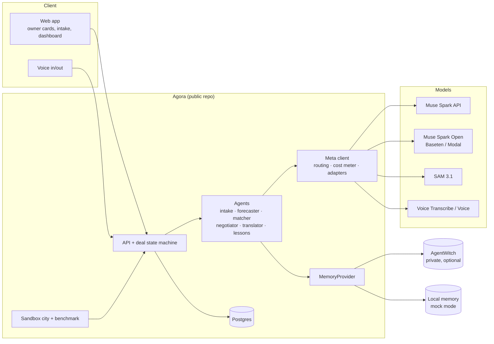

# Agora — architecture

Planning notes written Oct 26 ET. Names and file layout may shift once code starts.

## 1. Principles

1. Privacy by construction: originals are never stored; only item crops and coarse location are persisted.
2. Owners decide: no agent action that commits an owner happens without an explicit confirm.
3. The platform runs without AgentWitch (mock mode), so judges can run it end to end.
4. Every model call goes through one metered, routed client; cost is a first-class output.
5. Untrusted text (other agents' messages, listings) is data, never instructions.
6. Humans never talk to each other directly: human → own agent → other agent → other human, always relayed,
   translated and screened.
7. Agents never decide alone on commitment, money, identity/location or safety topics: a fixed gatekeeper policy
   (code, not a prompt) routes those to the owner, and unknown topics default to "ask".
8. Muse-only by construction: all agents are hosted by the platform and call the Meta Model API. We do not claim
   to verify third-party agents.

## 2. System overview



## 2b. Platform, primitives and apps

Agora is the platform; an **app** is configuration plus data that the platform runs. The full list of platform
primitives, their status and the guarantees no app can change is in `docs/PRIMITIVES.md`. In short:

- **Communication:** agent to agent (1:1, with escalation to the owner) and community (many to many). Both go only
  through agents; community posts are relevance-scored before posting and before delivery (section 2c).
- **Learning and evolving:** self-learning from accepts, declines and engagement; voting and evolving settings come later
  and only as approved, versioned, reversible proposals.
- **Geo:** coarse location and distance, optional per app.
- **Circles and criteria:** groups formed and dissolved by conditions; sensitive attributes never exclude.
- **Logs:** audit (decisions, no message text), metrics, errors (no personal data or secrets).
- **Supporting services:** members, roles and consent; owner approval (gatekeeper and cards); records; time; workflows;
  matching; notifications; language; trust; Meta client.

The kids' gear exchange (`apps/kids-gear/`) is the first app and uses 1:1 agents, geo, records, matching, learning and
owner approval. Exchange is one use case, not the platform.

| Layer | Folder | Owns | May import |
|---|---|---|---|
| Platform core | `src/` | slices, hubs, deal state machine, gatekeeper engine, relay, trust, learning, API, UI shell | never `apps/` (except the registry in `src/lib/app-config/load-app.ts`) |
| App | `apps/<id>/` | `app.config.ts` (catalog, policies, theme), sandbox community, golden sets, app REQUIREMENTS | only `@agora/app-config` |

The app config today describes the exchange use case: participant noun and profile fields, catalog (categories, size
systems, conditions, stages for the forecast), policies (negotiation rounds, handoff modes, gatekeeper topic table,
standing-rule topics, safety rules, languages, location granularity), theme, and the sandbox folder. It is validated by
`src/lib/app-config/schema.ts`. Planned reshaping (not yet done, BR-38): the exchange-specific settings (catalog, handover modes, pricing, negotiation rounds, forecast
stages) move into an optional `exchange` section, and `community` (purpose, topics, roles, relevance thresholds) and `circles`
become sibling sections, so an app that is not an exchange is valid. The safety settings (always-ask topics, unknown-topic default)
stay top-level. Existing apps migrate mechanically. Until this lands, only exchange apps are valid and the docs must not imply
otherwise. The primitive-to-slice map is in `docs/PRIMITIVES.md`.

**Apps as data (BR-41, `docs/PLAN.md` §2c step 1).** An app is either a repository app (`apps/<id>/`, one registry line in
`load-app.ts`) or a stored config. `src/lib/app-config/app-store.ts` validates a config with `appConfigSchema` before it is
stored and again when it is read, keeps ids unique (3–40 lowercase letters, digits, dashes; never a repository id or a reserved
word such as `muse` or `new`), caps the number of stored apps at 200, and refuses a sandbox path that leaves the app. Backends:
the `apps` table (migration 0012, primary key = id), a JSON file next to `AGORA_STATE_FILE` (`<file>.apps.json`), or memory. The
entry layer (`src/app/_composition/apps.ts`) creates the store from the environment and registers it, and `loadApp(id)` reads
repository apps first, then the registered store, so `src/` still never imports `apps/` beyond the registry line.
`POST /api/apps` creates one, `GET /api/apps/{app}` returns the public summary (name, tagline, region, noun, languages), and
`/app/{app}` (`/agora/app/{app}` in production) is its page. **Per-app scoping:** `getPlatform(appId)` builds one platform per
app (own catalog, deals, cards, relay, audit, feed) and every API route takes `?app={id}` (default: the demo app `APP`). Only the
demo app is seeded with the Mia and Jonas scenario; other apps start empty. Saved state is per app (`app_state` row `platform:<app>`
or file `<AGORA_STATE_FILE>.<app>`; the demo app keeps its original name). Not yet: members and personas of their own (the two demo personas still stand in for owners in every app), the member status page (step 5).
**Muse read API (step 6, BR-44):** a person's own Muse reads, never decides. `src/lib/identity/muse-keys.ts` keeps per-member keys (`agmk_` + 256 random bits; only the SHA-256 is stored, in the `muse-keys` row/file next to identity; shown once; revocable; at most 3 active). Only a signed-in person (cookie session, `assertHuman`) makes or revokes keys (`/api/apps/{app}/muse-key`). `src/app/_composition/muse-api.ts` is the one reader behind two doors: `GET /api/muse/{app}/overview|status|actions|cards` (Bearer or `X-Api-Key`, never a URL) and the same four tools over stateless MCP streamable HTTP (`/api/muse/{app}/mcp`, POST, JSON replies). `authorizeMuse` returns the same 401 for a missing, wrong, revoked, other-app or demo-app key. It reuses `memberStatusFor` and the new `memberActionsFor`, taking the member from the key so no input can name another member. No route exports POST/PUT/PATCH/DELETE under `/api/muse`, no tool writes, and card routes accept only cookie sessions, so a key cannot answer a card (BR-07). Rate limits: 60/min per key, 120/min and 20 wrong keys per 15 min per address (`src/lib/rate-limit.ts`). Replies carry a `notice` that the text is data. `docs/MUSE-CONNECTOR.md` says honestly that a real Muse has not been tried (MCP in the consumer app unconfirmed, §2d of the plan).

**Member status page (step 5, BR-43):** `/app/{app}/muse/{id}` is built by `memberStatusView` (`src/app/_composition/member-status.ts`). It authenticates the app's session cookie and requires `memberId === {id}`; every other case (other member, creator, stranger, forged cookie, unknown id or app, demo app) is the same 404, so ids cannot be probed. The data comes from the app's own platform (`getPlatform(appId)`) through the existing read views keyed by member id: owner cards, deals, catalog items, learning lessons and suggestions, standing rules. "What the agent did alone" is derived from the member's own deals (rounds, agreements, a 7-day step count per day) because the audit store is still a stub, and the page says so. Nothing in it is message text. A stored app's members are not yet wired into the app's platform as parties (no items or deals can be created for them), so today the groups are empty for them; they fill as soon as that wiring lands. The page is read-only; step 6 reuses `memberStatusFor` for the Muse read API.

**Overview, invite and join page (step 4, BR-42):** `/app/{app}` is one address with three views, chosen by `appPageView` (`src/app/_composition/app-views.ts`) from the app's session cookie only: stranger (join page with name, purpose, features and rules from `describeApp`, `src/lib/app-config/describe.ts`, plus the Join button), member, creator (overview, invite QR from `src/lib/qr.ts`, member list). The invite link is `appUrl(id)` (`https://agentwitch.com/agora/app/{app}`): the app's own address, no secret, so anything a forwarded link or screenshot can show is the join page. Anyone with the link can join (an invite secret that the creator can rotate is a later hardening); the member cap and light identity still apply. Repository apps get a public page without invite. Creating an app is still open to anyone (rate limited, capped) but now makes the caller its creator (light identity, below).

**Light identity (BR-45, `docs/PLAN.md` §2c step 2).** `src/lib/identity` is app-agnostic. A *membership* (app, role `creator`
or `member`, a random 128-bit member id) is created when someone creates an app (creator) or taps Join on the invite page
(member). A *session* is a 256-bit random token that only its SHA-256 is stored for; the browser holds it in an `agora_s_<app>`
cookie (HttpOnly, SameSite=Lax, Secure over https, 30 days, `no-store` on the answers that set it). It is read from the cookie only,
never from a URL, query or body, so screenshots and forwarded links cannot leak it. A session belongs to one app: it is refused for
any other. The member id may appear in URLs (`/app/{app}/muse/{id}`) because it only names a page; opening it needs the session of
that member (`assertSelf`). **Authorization:** `route()` (all platform routes) demands a valid session for the app when it is a
stored app, and a human session for every write (`assertHuman`: a principal that came in as `via: "muse"` can read and never write,
so it can never answer an owner card, BR-07); `authorize(req, app, role?)` gives creator-only routes (`GET /api/apps/{app}/members`).
Repository apps (kids-gear, garden-tools) keep the two personas and need no session. **Recovery:** each membership gets a 100-bit
recovery code, shown once. `POST /api/apps/{app}/recover` (code in the body, 8 tries per 15 minutes per address) opens a session
on the new phone, ends every older session and replaces the code, so a copied or used code is dead. Storage: one document
(`app_state` row `identity`, or `<AGORA_STATE_FILE>.identity.json`, else memory), replaced on every change. **What it is not:**
no proof of who anyone is. Whoever holds a session or the code is that member; losing both loses the membership. Every response
that grants a session carries that notice (`LIGHT_IDENTITY_NOTICE`). Join is open to anyone who finds the app (capped at 500
members per app); an invite secret is step 4's decision. Rate limiting still keys on `x-forwarded-for`.

Slice naming: `family`, `catalog` and the deal vocabulary are exchange-flavoured. `family` becomes `members` when the community
section lands (cheap now, expensive later); `catalog` stays the exchange recipe's records.

Invariants the platform enforces regardless of app: the always-ask topics (commitment, price/terms, identity and
location reveal, shipping choice, safety exception) cannot be relaxed or turned into standing rules; unknown topics
default to ask; the relay channel, trust screening, relevance filtering and privacy rules are not configurable.
`APP=<id>` selects the active app; apps are registered in `load-app.ts`. Creating a new app is covered in
`docs/CREATE-AN-APP.md`.

Planned for the Muse-first demo (decided Oct 28, not built; `docs/PLAN.md` §2c, BR-39 to BR-45): apps also become data. A
config created by the interview is stored by the platform, validated by the same `schema.ts` at load, and served at
`/agora/app/{app}`; several apps run in one process with their stores scoped per app, and repository apps stay
registered as today. A person's own Muse is a client (read-only MCP, if it can connect), never the deciding agent: agents
stay platform-hosted and the gatekeeper stays in code.

## 2c. Community communication, circles and logs (designed, not built)

**Community posting.** A member never posts or chats directly. The flow is: member asks their agent to post, the agent
drafts, the **relevance gate** scores the draft against the community purpose and topics (`postMin`), the draft passes
trust screening (contact details, scam patterns) and the gatekeeper (commitments, money terms and identity or location
requests ask the owner), then it is relayed to the community as the agent's post. On the receiving side each member's
agent scores the post against that member's interests, circles, location and engagement (`deliverMin`): below it the
post is ignored (no notification, at most a digest count); above it, it is translated and delivered. Scores combine
deterministic features (topic and keyword match, circle, proximity, past engagement) with an optional schema-validated
model similarity score from the Meta client; the deterministic score is used if the model is unavailable or over
budget. Post text is untrusted data and cannot influence its own score. Rate limits per member and per community and
duplicate suppression apply. Admin announcements and direct chat are after the hackathon.

**Circles.** A circle is a saved set of criteria (profile fields, distance, interests, level, availability, role,
favourites, joined with and / or / not) evaluated over members. Membership is consent-based and re-evaluated when
members or criteria change. Sensitive attributes (gender, religion, ethnicity, health, anything about minors) can never
exclude someone; they may define opt-in inclusion groups only. No health data is stored at all.

**Logs.** Audit log: append-only decisions (gatekeeper topics and outcomes, owner-card answers, consent and rule changes,
circle changes, approved evolutions), 12 months, no message text or secrets. Metrics: aggregate counts, cost, latency,
interruptions, relevance pass rates, 90 days. Errors: error class, route, request id and secret fingerprints only,
30 days. Members can view, export and erase their own audit entries.

**Relevance safety valves.** System notices about a member's own deals, safety or recalls are not posts and bypass relevance
filtering. Each member sees a count of posts filtered for them, can review them, and can tune their own thresholds; a
"not interested" answer becomes a lesson they can see and delete. Filtering decisions are audited as counts, without text.
Cost: a deterministic prefilter first, then one similarity per post (cached) compared with member-interest vectors, never one
model call per member per post (NFR-09); per-member and per-community post caps bound the load.

**Moderation (minimal, tier 2).** Roles are admin and member. A member can report a post (the existing hash-chained report
flow applies), an admin can hide a post or remove a member, and trust screening runs on posts as on 1:1 messages. Admin
announcements stay after the hackathon.

**Fairness enforcement.** Circle criteria are built from an allow-list of profile fields checked by the config schema, the same
way profile fields that look like health data are already refused. Sensitive attributes can define only opt-in inclusion groups.

**Retention and erasure.** Every kind of stored data has a stated retention in `docs/PRIVACY.md`. Erasing a member removes their
own data and unlinks their audit entries from them (only anonymous decision counts remain), so the audit log stays append-only.

## 3. Project structure (Fractal Slice Architecture)

Same conventions as AgentWitch (ADR 0007): one Next.js app; each capability is a slice under `src/features/<slug>/`
with `public-api/` (the only door in) and `internal/` (private); cross-slice effects go through a hub; `route.ts`
files stay thin.

```
agora/
├── apps/
│   └── kids-gear/                        # example app: app.config.ts, sandbox-city/, REQUIREMENTS.md
├── src/
│   ├── app/                              # entry layer: Next.js routes only
│   │   ├── (owner)/                      # onboarding, items, matches, deals/[id], cards
│   │   ├── (judge)/dashboard/            # judge-facing dashboard
│   │   ├── styleguide/                   # public read-only design-system page
│   │   └── api/**/route.ts               # thin: auth → call a slice's public-api/infrastructure
│   ├── features/                     # 16 slices; each holds nested sub-features (fractal, max 2 levels)
│   │   ├── catalog/      # offers and wants, outgrown/next-needed forecast
│   │   │   ├── features/forecast/
│   │   │   └── features/items/
│   │   ├── dashboard/    # judge-facing panels
│   │   │   ├── features/city-map/
│   │   │   ├── features/cost-panel/
│   │   │   ├── features/learning-curve/
│   │   │   ├── features/live-feed/
│   │   │   ├── features/privacy-panel/
│   │   │   └── features/safety-panel/
│   │   ├── family/       # profile, language, district, consent
│   │   │   ├── features/consent/
│   │   │   └── features/profile/
│   │   ├── gatekeeper/   # auto/ask/forbid policy + topic classifier
│   │   │   ├── features/classifier/
│   │   │   └── features/policy/
│   │   ├── intake/       # photo → separated items; originals discarded
│   │   │   ├── features/capture/
│   │   │   ├── features/crops/
│   │   │   ├── features/labeling/
│   │   │   └── features/segmentation/
│   │   ├── language/     # translation, language detection
│   │   │   ├── features/detection/
│   │   │   └── features/translation/
│   │   ├── learning/     # lessons from accept/decline, standing-rule proposals
│   │   │   ├── features/lessons/
│   │   │   └── features/standing-rules/
│   │   ├── logistics/    # handoff modes, shipping, carrier adapters
│   │   │   ├── features/carriers/
│   │   │   ├── features/handoff/
│   │   │   └── features/shipping/
│   │   ├── matching/     # candidate lookup and scoring
│   │   │   ├── features/candidates/
│   │   │   └── features/scoring/
│   │   ├── memory/       # MemoryProvider: local + AgentWitch
│   │   │   ├── features/agentwitch/
│   │   │   └── features/local/
│   │   ├── negotiation/  # agents, offers, deal state machine, relay, deal room
│   │   │   ├── features/deal-room/
│   │   │   ├── features/deal-state/
│   │   │   ├── features/negotiator/
│   │   │   ├── features/offers/
│   │   │   └── features/relay/
│   │   ├── owner-cards/  # owner questions, confirm/decline, mandates
│   │   │   ├── features/confirmations/
│   │   │   ├── features/mandates/
│   │   │   └── features/questions/
│   │   ├── safety/       # category rules, recall links
│   │   │   ├── features/category-rules/
│   │   │   └── features/recalls/
│   │   ├── simulation/   # sandbox city, benchmark (dev/judge tool)
│   │   │   ├── features/benchmark/
│   │   │   ├── features/city/
│   │   │   └── features/simulated-owner/
│   │   ├── trust/        # screening, scam signals, reports, reputation
│   │   │   ├── features/reports/
│   │   │   ├── features/reputation/
│   │   │   ├── features/scam-signals/
│   │   │   └── features/screening/
│   │   ├── voice/        # voice in/out
│   │   │   ├── features/speak/
│   │   │   ├── features/transcribe/
│   │   │   └── features/voice-ui/
│   ├── hubs/
│   │   └── DealEvents/                   # command.ts (producers) · query.ts (consumers) · types.ts
│   ├── lib/                              # domain-agnostic: db, queue, crypto, rate-limit, flags, audit, env
│   │   └── meta/                         # Meta Model API client, model routing, cost meter, Baseten/Modal adapters
│   └── components/                       # design-system UI; never imports a feature's internal/
├── db/migrations/                        # SQL, each slice's tables prefixed by slice
├── evals/                                # golden sets and thresholds for real-model evaluation
├── fixtures/                             # recorded model outputs, seeded sandbox city
├── e2e/                                  # planned Playwright flows (not built; API journey tests stand in)
├── docs/                                 # PLAN.md, ARCHITECTURE.md, adr/
├── .github/workflows/ci.yml
├── eslint.config.mjs                     # boundary rules (no cross-slice internal imports)
├── structure-validation.config.json      # allowed folders per level (empty placeholder; not built)
└── README.md
```

### How the fractal nesting works

- **Every level has the same shape:** `public-api/{presentation,infrastructure,client,types}.ts` (only the files
  that level needs) and `internal/{core,infrastructure,presentation}/`. Tests are co-located.
- **Parent slice = facade + orchestration.** Its `public-api` is what the rest of the app sees; its `internal/`
  holds only coordination (for example `intake.pipeline.ts`, `deal-runner.worker.ts`). Capability logic lives in
  the sub-features.
- **Sub-features are separate capabilities with their own deletion test.** Example: `negotiation/features/relay`
  can be removed and negotiation still runs, only without the human relay; `logistics/features/carriers` can be
  swapped without touching `shipping`.
- **Siblings talk through each other's `public-api`, never `internal/`.** A parent may use its children's
  `public-api`; a child never imports its parent's `internal/`.
- **Depth limit: two levels** (slice → sub-feature). Anything that would nest deeper becomes a sibling instead
  (carriers sit beside shipping, not under it). This keeps the tree navigable and the boilerplate small.
- **Why nest here:** it keeps each hackathon work item (for example "scam signals") a small, independently
  testable, independently deletable unit, and it lets several people work in parallel without file conflicts.

### Slice map

| Slice | Sub-features | Owns (tables / data) |
|---|---|---|
| family | profile, consent | families, consent |
| intake | capture, segmentation, labeling, crops | none persisted except crops |
| catalog | items, forecast | items |
| matching | candidates, scoring | matches |
| negotiation | offers, deal-state, negotiator, relay, deal-room | negotiations, messages, relay_messages |
| gatekeeper | policy, classifier | none (pure policy) |
| owner-cards | questions, confirmations, mandates | owner_questions, confirmations, mandates |
| logistics | handoff, shipping, carriers | handoffs, shipments |
| trust | screening, scam-signals, reports, reputation | trust_reports, agent_status |
| safety | category-rules, recalls | none (rules) |
| learning | lessons, standing-rules | lessons |
| memory | local, agentwitch | local lessons store; AgentWitch client |
| language | translation, detection | none |
| voice | transcribe, speak, voice-ui | none |
| dashboard | city-map, live-feed, learning-curve, cost-panel, privacy-panel, safety-panel | none (read models) |
| simulation | city, simulated-owner, benchmark | none |

### Cross-slice flow: the `DealEvents` hub

Producers import the hub's `command` API; consumers import its `query`/listener API. The hub imports no feature.

| Event | Producer | Consumers |
|---|---|---|
| DealAgreedByAgents | negotiation | owner-cards (open confirm cards) |
| OwnerQuestionOpened | negotiation / gatekeeper | owner-cards |
| DealConfirmed | owner-cards | logistics (create handoff), learning, memory |
| DealDeclined | owner-cards | learning, memory |
| ShipmentUpdated | logistics | negotiation (advance state) |
| ReportFiled | owner-cards / trust | trust |

### Rules (from ADR 0007, applied here)

1. A slice imports another slice only via its `public-api/*`, never its `internal/**`.
2. `'use client'` files never import `public-api/infrastructure` or `internal/infrastructure/**`.
3. `route.ts` stays under `src/app/api/**` and only authenticates, validates, calls a facade, returns.
4. `lib/` and `components/` never import a slice.
5. Hubs import no slice; cross-slice side effects go through a hub, not direct calls or a global event bus.
6. Deletion test: removing `voice/` (plus its route wiring) leaves the app working; removing `logistics/` leaves
   deals ending at "confirmed, pickup by owners"; removing `simulation/` changes nothing for users.
7. Enforced by ESLint boundary rules (`no-restricted-imports`) in CI. Structure validation (allowed folders per level) is planned, not built.

## 4. Data model (Postgres)

- `families`: id, language, district_code (coarse, ~5km), baby_age_months, size_profile (jsonb), memory_ref
- `agents`: id, family_id, display_name, passport (public id), created_at
- `items`: id, family_id, kind (`offer`|`want`), category, size_range, condition, crop_url, status, safety_flags (jsonb)
- `matches`: id, offer_item_id, want_item_id, score, distance_band
- `negotiations`: id, match_id, state, round, created_at, updated_at
- `messages`: id, negotiation_id, from_agent_id, round, structured (jsonb), text_original, lang_original, text_translated, lang_translated
- `confirmations`: negotiation_id, family_id, decision (`confirm`|`decline`), reason_code, reason_text, decided_at
- `relay_messages`: id, negotiation_id, from_family_id, to_family_id, text_original, text_relayed, lang_from, lang_to, screened (bool), blocked_reason
- `handoffs`: negotiation_id, mode (`pickup`|`locker`|`parcel_shop`|`shipping`), plan_state, approvals, pickup_window, revealed_location (encrypted), drop_point, checklist (jsonb), outcome, outcome_reason
- `shipments`: id, negotiation_id, sender and recipient family, recipient_place_enc (encrypted), carrier, mode (`simulated`|`test`), label_ref, tracking_ref, appointment (jsonb), fee_split (jsonb, percents only), status
- `trust_reports`: id, negotiation_id, reporter_family_id, reported_agent_id, reason_code, evidence_bundle (jsonb: transcript hash, timestamps, screening flags), status, exported_at
- `agent_status`: agent_id, trust_score, banned (bool), notes
- `mandates`: id, family_id, topic, level (`auto`), scope (jsonb), expires_at, source (`owner`|`learned_with_consent`); never an always-ask or forbidden topic, one per family and topic
- `owner_limits`: family_id, max_distance_km, blocked_categories, availability (jsonb), min_condition, allowed_terms
- `owner_questions`: id, negotiation_id, family_id, topic, question, suggested_answers (jsonb), counterparty_context (redacted), status (`open`|`answered`|`expired`), answer, answered_at
- `stretch_offers`: family_id, want_item_id, offer_item_id, counterpart_id, category, reasons, status (pending offers only; removed when answered or after 30 days)
- `lessons`: id, family_id, kind (`decline`|`accept`|`stretch`), lesson_key, text, evidence_ids, seen_count, confidence, source (`agentwitch`|`local`)
- `deal_outcomes`: family_id, negotiation_id, result, reason_code, category
- `rule_proposals`: family_id, topic, evidence_count, status (suggestions only)
- `model_calls`: id, role, model, tokens_in, tokens_out, cost_usd, latency_ms, created_at

Exact addresses are held only in `handoffs.revealed_location`, written after both confirmations.

## 5. Deal state machine (`src/features/negotiation/features/deal-state`)

```
proposed -> countered (<= max rounds) -> agreed_by_agents -> awaiting_owners
awaiting_owners -> confirmed (both owners) | declined (either) | expired (24h)
confirmed -> handoff -> completed | not_completed
any open state -> awaiting_owner_input -> (back to the previous state on yes) | declined (on no) | expired
any state except declined, expired, reported -> reported (scam flag)
```

Rules: pure function `next(deal, event, time)`; illegal transitions throw; every transition is recorded with a time
(`history`); expiry is a call to `expireDue()` from a timer (not yet wired). A **round** is one offer from either agent:
the proposal is round 1 and the limit comes from the app config (`policies.maxNegotiationRounds`, 3 in both example
apps), so the fourth offer is refused and the deal ends. The wanting owner's agent proposes; the offering side answers
first; turns alternate.

**Agreement is not commitment.** `agreed_by_agents` only opens confirm cards for both owners; the deal is `confirmed`
only when both owners confirmed (invariant tested over thousands of random event sequences). Money is never held by
the platform; a `price` term is settled by the owners outside it.

Offer message (structured, language-neutral, built per app from its config):

```json
{ "itemId": "...", "terms": "free|swap|price", "price": { "amount": 5, "currency": "EUR" },
  "swapFor": "a trowel", "condition": "good",
  "pickupWindow": { "from": "2026-11-02T10:00Z", "to": "2026-11-02T14:00Z" }, "note": "short, harmless" }
```

Which terms are allowed follows the app's pricing mode (free_only, swap_only, free_or_agreement). `price` appears only
with `price` terms and `swapFor` only with `swap` terms.

How a turn works: the agent's decision is a pure function (`decideTurn`) over its owner's mandate (allowed terms,
minimum condition, availability, language). It declines below the condition floor or for terms the owner will not
consider; it asks the owner for any terms other than free unless that owner chose or already approved those exact
terms in this deal; it stays inside the owner's availability (countering with the owner's window, asking first unless
a standing rule applies); otherwise it accepts provisionally. The gatekeeper has the last word on every topic.
Notes from the other agent are passed through the gatekeeper and dropped if they ask for anything or give an
instruction (flag on the deal); our own notes are written by the Meta client (role `negotiator`), validated, checked
as harmless, and replaced by a per-language template on any failure. Starting a deal holds both items so an item
cannot be promised twice; declined and expired deals release them; confirmed deals reserve them for that deal.

Not built yet: the expiry timer, and a relational Postgres repository (the in-memory repository matches migration
0004; the demo is saved as one document instead, see Demo persistence). Per-owner translation of notes and the relay channel are built (see Language and Relay below).

## 6. Agents and model routing

| Agent | Job | Model | Why |
|---|---|---|---|
| Interviewer | Offer example answers and draft the app (tagline, what to call a member, categories, forbidden things, wishes) during the create-an-app interview; code decides everything else | Muse Spark API | Plain-language drafting; see §11d |
| Intake | Separate items in a photo, label category/size/condition | SAM 3.1 + Muse Spark (vision) | Segmentation + reading |
| Forecaster | Outgrown / next-needed from stage table + sizes | Spark Open | Cheap, structured |
| Matcher | Score offers vs wants | Deterministic function, Spark Open for tie-breaks | Predictable, cheap |
| Negotiator | Propose/counter within owner's learned limits | Muse Spark API | Reasoning quality |
| Translator | Translate messages for each owner | Muse Spark API | Multilingual |
| Lessons | Summarize accept/decline reasons into reusable lessons | Spark Open | Cheap, private-ish |
| Logistics | Agree pickup / locker / shipping; request label and appointment from the carrier adapter | Muse Spark API + carrier adapter | Needs both sides' constraints |
| Trust | Screen relays for contact details and scam patterns; build evidence bundles | Spark Open + rules | Cheap, runs on every message |
| Voice | Voice in/out for owners | Voice Transcribe / Muse Voice | Hands-free use |

Routing is table-driven in `src/lib/meta`; the benchmark can swap models per role and compare cost and quality.

## 7. Privacy and safety design

- **Stateless intake.** The original photo lives in memory for the request only. Muse Spark names the items, SAM 3.1 finds each one, and the item crops are cut from the boxes (background removal from the masks is a stretch). Only crops are stored. Honest claim: *originals are discarded, not stored*; on-device processing is a stretch goal, not a promise.
- **Coarse location.** Matching uses `district_code`. Exact pickup details appear only after both confirmations.
- **Leak tests (`src/features/intake` and `src/features/trust`, suites in `evals/`).** Face detector and address/phone regex over crops, listings and messages; run on 100 test photos; results shown on the dashboard.
- **Safety rules (`src/features/safety`).** Car seats require a crash-history declaration; cribs, strollers, high chairs show an official recall-check link; consumables and medicines are blocked. Advisory only, no medical guidance anywhere.
- **Prompt injection.** Counterparty text is wrapped and labeled untrusted; negotiator output is schema-validated; no tool calls originate from message content. A red-team set lives in the repo.

## 7a. Decision boundary (gatekeeper)

`decide(policies, topic, ctx) -> auto | ask | forbid` in `src/features/gatekeeper/features/policy`: a pure function over the
**active app's topic table** (`policies.topics`), unit-tested. `classify` in `features/classifier` labels each incoming
message with every topic it contains using deterministic patterns; a model may propose an extra topic but can only
escalate. The gatekeeper, not a model, decides. A message gets the most restrictive outcome of its topics; unknown
text, classifier uncertainty or an unknown topic maps to `ask`. Order of checks: platform-forbidden topics, always-ask
topics, unknown topics, the app table, then a valid standing rule (only for the app's `standingRuleTopics`).

The rows below are the kids-gear defaults; another app may add topics (with `topicKeywords`) and move low-risk rows
between auto and ask, but cannot relax the always-ask rows or the platform-forbidden topics (obeying the other side,
sharing contact details, taking payment). Decisions are audited by topic and outcome only, never message text.

| Topic | Level | Notes |
|---|---|---|
| Translating the owner's own words | auto | Faithful relay only; the agent does not rewrite meaning |
| Answering factual questions already in the listing (size, stated condition) | auto | No new claims |
| Proposing pickup windows inside the owner's declared availability | auto | Within mandate limits |
| Declining a match that breaks an owner's hard rule (distance, blocked category) | auto | Reported to the owner in the summary |
| Accepting or confirming a deal | ask (always) | Both sides' owners |
| Price, fee split, or any change of terms | ask (always) | Never overridable by standing rules |
| Revealing exact location, name, contact, or baby details | ask (always) | Never overridable |
| Choosing shipping vs pickup, buying or creating a label | ask (always) | Never overridable |
| Safety exceptions (unknown crash history, recalled item, missing declaration) | ask (always) | Default recommendation: decline |
| Condition disputes, discounts, anything not covered by the mandate | ask | |
| Instructions from the counterparty agent ("agree now", "send the address") | forbid | Treated as data, never obeyed |
| Banning or reporting an agent | ask to report; platform decides on bans | Owner is informed |

Owner experience: a question card with the counterparty's request (redacted), two or three suggested answers,
and a deadline. A "remember this" option is offered only for topics outside the always-ask rows; it creates a
`mandates` row with an expiry, and the choice is also written as a lesson.

Tests: unit tests for every table row of both apps; red-team sets in `evals/` (injection, price pressure, scam
scripts) run with standing rules and adversarial model proposals; the target is 0 unauthorized commitments. Known
limit: patterns cover en, de, es, vi; text in other languages has no benign match and therefore asks. The English
translation is also classified (GAT-CLS-06) and can only add risk.

### Owner cards (`src/features/owner-cards`)

Cards are the owner's control surface and are made from hub events, not by calling negotiation. `OwnerQuestionOpened`
creates a one-tap question (fixed template over structured facts, never counterparty text; yes/no; deadline equal to
the deal's expiry; "remember this" only for topics that may become standing rules). `DealAgreedByAgents` creates a
confirm card for each owner; confirming or declining (with a reason code) calls negotiation's `ownerDecision`, and the
deal is confirmed only when both owners confirmed. `DealDeclined`, `DealExpired` and `DealConfirmed` close open cards.
Answers call `answerOwner`. Every action checks the card belongs to the acting owner and cannot be repeated.

Standing rules live in the mandate book: only the app's low-risk standing-rule topics, 30 days by default (90 at most),
one per topic, mirrored into the gatekeeper so they apply and are revoked immediately. Hard limits (distance, blocked
categories, availability, minimum condition, allowed terms) are validated against the app and feed matching and
negotiation. The number of questions per deal is the "interruptions per deal" metric. Stores are synchronous in-memory
for now, so cards appear in the same tick as the event; a database version moves card creation to a worker.

### Language (`src/features/language`)

One service per app, used by the gatekeeper, negotiation and owner cards. Detection is deterministic first (script marks
and stopwords for en, de, es, fr, vi) and asks a model only when unsure, accepting an answer only if it names one of the
app's languages. Translation goes through the Meta client (role `translator`): the text is sent as JSON data, the reply
must be a validated object, a translation that changes a number, size, date or time is rejected, low confidence is
marked uncertain, results are cached, and a failure returns a reason instead of invented text. Uses:
- Gatekeeper: incoming notes are classified in the original and in English; the English version can only add risky topics.
- Negotiation: `transcriptFor` shows each owner the original and a translation in their language (failures marked).
- Owner cards: fixed wording packs for en, de, es and vi; other languages are translated, with English kept on failure.

Known limits: automatic handling (auto) still needs a deterministic benign match in the original, so text in other
languages asks the owner; translation quality is unmeasured until a real Meta key allows the G0 round-trip test.

## 7b. Relay channel, logistics and trust

**Relay (human → agent → agent → human)** (`src/features/negotiation/features/relay`). An owner only ever talks to their own
agent. The message is screened (phones, emails, handles and links replaced; addresses and payment requests blocked, with a
plain reason for the sender), translated faithfully (numbers, sizes and dates must survive and the length must be sane,
otherwise the original is delivered and marked untranslated), screened again (anything the translator added holds the
message), and delivered by the other owner's agent. The gatekeeper labels topics only so the receiver can be told that
nothing agreed in chat counts: terms and commitments change only through structured offers and owner cards. Both owners see the
original and the relayed text; the receiver's "original" is the screened one. Limits: 1000 characters, 30 messages per hour
per sender and deal, banned agents cannot relay, only the deal's two owners may read or send. The database keeps the screened
text and the hash of each message, never the raw text. No direct human-to-human channel exists.

**Logistics** (`src/features/logistics`). A handover plan is created from the `DealConfirmed` event, never before, so
before both owners confirm the handoff card is empty. The proposal (`proposeMode`, pure) prefers a locker, then a shop,
then pickup, then shipping; in-person modes need both owners within their distance limits (an unknown distance never
satisfies one) and a shared free window; shipping needs only to be allowed by the app and both owners. Either owner can
propose another allowed mode (clears approvals, at most 3 changes). When both owners approve, the deal moves to `handoff`.
- `pickup`: only the owner giving the item writes the exact meeting place; it is encrypted at rest and shown to the other
  owner only after both approved the way to hand over.
- `locker` / `parcel_shop`: a public drop point near the host; neither home place is shown.
- `shipping`: the recipient gives a delivery address (encrypted, only after both approved shipping); only the sender creates
  the label and books the appointment; the label text, which contains the address, goes to the sender only. Guard:
  deal in handoff, mode shipping, both owners approved including the sender, sender acting, address present, no label yet.
  The agreed fee split is recorded as two whole percents adding to 100; no amount, currency or payment field exists and a
  test scans the code for payment identifiers.

Carrier port (`src/features/logistics/features/carriers`): `createLabel`, `bookAppointment`, `track`, always zero cost.
`simulated` (default everywhere; deterministic, watermarked, tracking driven by the clock) passes the shared contract suite;
a real test-mode carrier is not built. Exact places and addresses use AES-256-GCM with an application secret of at least 16
characters (`FIELD_ENCRYPTION_SECRET`, required in live mode together with `REPORT_EXPORT_SECRET`) and a fresh IV per value. Tracking changes publish `ShipmentUpdated`; delivery or an
owner marking the outcome (completed, or not completed with a reason: no_show, item_mismatch, changed_mind, other) calls
`finishHandoff`, completes or releases both items and publishes `HandoffFinished`. Every handoff card shows a short safety
checklist (logistics only, plus the app's safety lines for the item). Not built yet: owner-card screens for the handoff
card, notifications, a real drop-point lookup.

**Muse-only by construction.** Agents are created and run by the platform with its Meta Model API credentials;
a `passport` identifies each. Third-party agents are not accepted in v1. If Meta later provides an attestation
mechanism, `agents.passport` can carry it.

**Trust** (`src/features/trust`). Screening is a pure function over deterministic patterns (en, de, es, vi basics), with
dates, times, sizes and prices explicitly not read as phone numbers; decisions are logged by kind, never by text. Scam
signals (off-platform payment, contact sharing, pressure, address harvesting, listing mismatch, repeated cancellations)
produce a score and a plain explanation, with levels none, watch (20) and high (50); one weak signal never reaches high.
Reputation starts at 80 and changes by documented, explainable deltas: restricted below 50 (cannot start deals), banned
below 25 and only after at least three negative events (cannot relay); owners see only a three-level indicator. A report
(two taps: deal and reason) builds a hash-chained evidence bundle of message hashes, times and flags, stops the deal, frees
held items and lowers the reported agent's score; one report per reporter per deal. The reported party can learn only that
a report exists. Export uses the documented `agora.report.v1` format (docs/PROTOCOL.md) with keyed pseudonyms and no message
text. Whether Meta consumes such reports is unconfirmed; the docs and video say "designed for", not "reported to".
Not built yet: report review UI and operator tooling, listing-mismatch signals (need intake), persistence.

## 8. Memory (AgentWitch in the background)

```ts
interface MemoryProvider {
  getFamilyContext(familyId: string): Promise<Context>      // lessons and recent outcomes
  recordLesson(familyId: string, lesson: Lesson): Promise<void>  // insert or replace by id
  deleteLesson(familyId: string, lessonId: string): Promise<boolean>
  recordDealOutcome(familyId: string, outcome: Outcome): Promise<void>
  eraseFamily(familyId: string): Promise<void>
}
```

- `LocalProvider`: in memory today (Postgres tables in migration 0009); the default for judges and CI; every family has its own store.
- `AgentWitchProvider`: reads are always served from a local store (fast, complete, isolated). Lessons are mirrored to the
  family's AgentWitch project through `POST /knowledge/update`, and deal outcomes as tasks (call shape assumed, unverified).
  Mirroring happens only when the family consented and a project exists, because AgentWitch has no delete. A mirror failure
  never blocks anything: it is reported and retried up to 5 times by `flush()`; 409 (not paired) and 404 (no access) are never
  retried. Per-family project creation needs the private `create_project` change and is not built.
- Both pass one contract suite (empty start, replace by id, delete, family isolation, copies, erasure).

## 9. Learning loop (`src/features/learning`)

1. The owner confirms or declines with a reason code (`too_far`, `wrong_size`, `condition`, `price`, `timing`, `other`);
   owner cards publish `OwnerDecision` and `OwnerAnswered`; outcomes come from `DealConfirmed`, `DealDeclined`, `DealExpired`,
   `HandoffFinished`. Learning handles events one at a time, in order.
2. A lesson is written from structured facts only (reason code and category, never free text), so it can hold no names or
   places. Repeats merge on a key such as `decline:price:clothing`, raise confidence (0.5, 0.75, 0.875, capped at 0.95) and
   list the deals behind them; the same deal never counts twice.
3. From the second sighting a lesson acts, and only by tightening the owner's own limits: too far shrinks the distance (to 70%,
   10 km cap if none, floor 1 km), condition raises the floor one step, wrong size makes sizes exact for that category.
   Price, timing and other are recorded but change nothing. Adjustments have no field for topics, terms or commitments, so a
   lesson can never relax an always-ask topic; a property test checks that no limit ever gets looser.
4. Matching and negotiation use `limitsFor` and `tightenMandate`. The owner can see "what I learned about you" and delete any
   lesson; behaviour reverts at once because adjustments are derived from stored lessons each time.
5. Three identical yes answers in a row to one low-risk topic produce a standing-rule proposal in plain words; a no resets the
   count, dismissal is remembered, always-ask topics are never proposed, and nothing activates until the owner accepts (with
   an expiry).
6. **Relaxing with the owner's approval (stretch offers).** Tightening alone loses coverage when an owner's preferences loosen.
   When learned limits leave a want without a match, the caller looks again with the owner's own base limits; a candidate that only
   a learned limit excluded, and that is just beyond it (within 30% on distance, one condition step), becomes a **stretch offer**: a
   plain card ("about 8 km away, further than the 7 km you usually accept; look at it anyway?") that names no one. Nothing starts
   without the owner's yes, and the deal still needs both owners' confirmation. After a no, that reason is skipped for five
   opportunities, and at most three offers wait at once. A stretch deal that both owners confirm writes a `stretch` lesson, which
   counts twice against the matching decline lesson, so the limit loosens in steps (full, half, none) and tightens again with new
   declines; it never goes past the owner's own base limits and the owner can delete the lesson. Measured in `docs/SIMULATION.md`:
   cards are rare, and when preferences loosen they add about one confirmed deal per 100 wants over tightening alone. The larger
   effect is elsewhere: offering the next-best match after a decline closes about 90% of the gap to an oracle ceiling, at a cost in
   owner attention that learning cuts by about 70%; learned limits that exclude candidates cost coverage next to retry. Ordering
   candidates instead (beyond-limit ones last, behind a stretch card) was tested: it wins back at most about 40% of that coverage and
   only with many cards owners rarely approve, so the margin and back-off stay and an owner-chosen attention-versus-coverage setting is
   the next step. The two-step lookup and the retry are done only in the simulation
   harness today.
7. The simulation slice measures all of this (section 10).

## 10. Sandbox city and benchmark (`src/features/simulation`)

Full description, how to run it and the measured results are in `docs/SIMULATION.md`. In short:

- 20 synthetic families in three languages, from the app's sandbox files, placed on a synthetic map; some have free pickup hours.
- Simulated owners decide with **hidden rules** (maximum distance, minimum condition, exact size) generated from persona style and a
  seed, so learning is measured against ground truth. Nothing outside the slice references them.
- Each episode runs the real slices (catalog, matching, negotiation, gatekeeper, owner cards, learning) with deterministic ids and no
  live model. Per round the arm is measured on **held-out** episodes (never written back as lessons), then trained on separate ones;
  the learning-off arm is the baseline; several seeds give mean and range.
- Nine arms: learning off, tighten-only learning, learning with owner-approved relaxation, retry (the next-best match after a decline)
  with and without learning, three orderings of learned limits (product guards, no margin, no margin and no back-off), and an oracle
  ceiling that knows the hidden rules. A drift scenario makes half the families tolerate twice the distance from a chosen round.
- Output: JSON and CSV (every row `simulated=true`), failures kept. Model-routing comparison and cost per deal need a Meta key and are
  not run; the harness takes the same city and seeds for any routing.

## 11. Dashboard (judge-facing)

Built (demo mode): a single page at `/dashboard` that reads `reports/simulation/<scenario>/*.csv` through `loadDashboard` (generated by `npm run simulate`, or on first open). It shows a SIMULATED banner, KPI tiles, owner approval by round with min–max bands over seeds, confirmed deals per 100 wants with the oracle ceiling, owner cards per confirmed deal, failures, what is not measured, a map of where the simulated families live (synthetic grid, never real places), the safety checks (the repository's red-team, topic and screening sets run in the page, `src/app/_composition/safety-checks.ts`), and live demo counters (agent decisions, screening, cards). Charts are hand-written SVG with a table fallback. The scenario switch covers stable and changing preferences.
Not built: cost per deal (needs live model calls), and leak tests on photos (there is no photo intake).

**Look and styleguide.** Styling is Tailwind 4 (`@tailwindcss/postcss`, `postcss.config.mjs`) with Agora's own design tokens in `src/app/globals.css` (Tailwind's default palette plus one purple `brand` scale, a type scale, radii and shadows in `@theme`; semantic colours such as `--surface`, `--text`, `--border` exposed as `bg-surface`, `text-ink`, `border-line`; dark mode as a `dark` class on `<html>`). Agora's own page classes (`.btn`, `.card`, `.muted`, ...) live in the `components` layer and read the same tokens, so existing pages follow the palette while Tailwind utilities still win. All of it is original code written for this repository (see `THIRD_PARTY_LICENSES.md`). Generic components are in `src/components/ui/` (one file per family, re-exported from `index.ts`); `/styleguide` (slice `src/features/styleguide`, presentation only) shows them. Fonts are the system stack; no image files are used.

The owner and deal pages use the same entry layer: `src/app/_composition` is the composition root (wires slices, seeds the demo, builds read views); route handlers only validate (zod), rate limit (120/min/IP), call it and answer with `{error:{code,message}}` on failure.

## 11b. Demo persistence

Stores create their in-memory containers with `tracked(name, value)` (`src/lib/state.ts`). Inside the composition root's
scope every tracked Map, Set, array and object is part of one snapshot. After each successful non-GET request the entry
layer writes the snapshot (`src/app/_composition/persistence.ts`) to Postgres (`DATABASE_URL`, table `app_state`,
migration 0011) or to a file (`AGORA_STATE_FILE`), else nowhere; on start the platform restores it in place and skips
seeding. `POST /api/demo/reset` deletes it. A test restarts the platform mid-journey and checks every deal view is
identical and the journey finishes.

What this is not: the relational tables in migrations 0001–0010 (the target schema, with retention and erasure per
row) are still unused, there is one writer (no multi-process or multi-instance), the whole document is rewritten on each
change (fine for a demo, not for scale), and retention jobs do not exist. The snapshot holds the screened relay text, its
translation and hash, agent notes and encrypted handoff fields. It never holds what an owner typed before screening (the saved
copy substitutes the screened text, so after a restart the sender sees that), nor a plaintext address (the shipping label is
stored encrypted). Encrypted fields use the demo's hard-coded key, so they are not protected against anyone who has the
repository and the saved state. It is demo data, deleted with the reset.


## 11c. Photo intake (demo)

`POST /api/intake/photo` takes one photo (data URL; the page shrinks it to 1600 px and re-encodes it first) and returns item drafts. The steps, all in `src/features/intake`:

1. **Shrink and strip.** `sharp` rotates the photo upright, limits it to 1600 px and re-encodes it as JPEG, so camera metadata is gone. A file that is not a photo answers `unreadable`.
2. **Pixel check.** Too dark (mean brightness) or very blurry (edge-filter variation) answers `retake` before any model is paid for. This is a coarse filter; the vision model gives its own verdict next.
3. **Name the items.** One Muse Spark vision call (Meta client, role `intake`, schema-checked) lists each item with a name, a one-noun concept, the app's category, size only if printed on a visible label, condition if it can tell, a confidence, and flags for a person or readable text in the item's area. The prompt carries the app's own categories, sizes and conditions.
4. **Find each item.** One SAM 3.1 call per concept, in parallel; a multi-word concept that finds nothing is tried again as its last word ("board book" found nothing, "book" did); a failing call costs only that item its outline. Items flagged with a person or text are not sent to SAM at all.
5. **Crop and check.** Boxes are scaled, clamped, de-duplicated and padded 3 percent; a pair side by side is one item, several of a thing get one draft each when the count matches, and boxes far apart are not merged (the most confident is kept). Each crop is cut from the shrunk copy, shrunk to 480 px, and then looked at once more on its own by a separate Muse Spark call (person or readable text?, "when unsure, true"); a flagged crop is dropped, and if the check cannot run nothing is kept. Surviving crops are held by draft id.
6. **Discard.** The original bytes are overwritten with zeros as soon as the shrunk copy exists, and the shrunk copy before the call returns.

The owner then checks each draft (name, category, size, condition; anything guessed or low confidence says "please check") and lists the ones they want through `POST /api/items` with the draft id, which moves the picture to the item. Crops live in an in-memory store (`crops/internal/infrastructure/store-crops.ts`): drafts for 30 minutes, items until withdrawn. They are not in the saved demo state, so after a restart items work but show no picture.

`AGORA_INTAKE` picks the models: `simulated` (default, offline: three sample items from the app's own categories cut from fixed places on the photo, always "please check", and the page says no model looked at it) or `meta` (Muse Spark and SAM 3.1 through `META_API_KEY`; a separate Meta client with its own budget, so the rest of the demo stays on the mock client). Failures never reach the owner as errors: `retake`, `unreadable` and `unavailable` are answers the page explains, and the form below always still works.

### Measured (the intake eval)

`npm run evals:intake` (needs a Meta key) makes 24 photos with Muse Image from the prompts in `evals/intake-photos.ts` (12 piles of six items, 6 with an adult in the picture, 6 with a name and address on a label), runs each through the live path, and has a separate Muse Spark call look at every original and every kept crop. It writes names and counts only to `evals/intake-eval.results.json` (committed; `evals/intake-eval.test.ts` checks the file matches its rows and holds no picture data), and the judge dashboard shows it. Photos are cached under `reports/intake-photos` (not committed) so reruns only pay for the model calls.

| Oct 28 | First run (labeling flags only) | After crop check, head-noun retry and box rule |
|---|---|---|
| Piles split into exactly six drafts | 11 of 12 | 11 of 12 |
| Expected items found and named | 97.2% | 97.2% |
| Drafts that were a real item | 95.9% | 93.3% |
| Pile drafts with a picture | 78.1% | 84.0% |
| Crops judged to show a person or readable text | 6 of 80 (7.5%), all people, in 3 of the 6 person photos; 0 text | 0 of 87 |
| Items with no picture kept for person or text | 17 | 21 (2 of them in pile photos, which have no people or text: false alarms) |
| Photos where the judge saw a person / readable text in the original | 6 of 6 / 6 of 6 | same |

The first run is what found the leak: the labeling call flagged the person in 6 items correctly but missed 6 crops of toys with a hand or body at the edge; the per-crop check closed it on this set. Cost of the second run, estimated at the press-reported Muse Spark rate (no SAM or image price known): about $0.60 for 233 Muse Spark calls, 108 SAM calls and no image generation, roughly 10 s per photo from upload to drafts (the first run's 16 s included making the photo).

Limits that matter: the photos are generated, not taken; the judge is Muse Spark, the same family as the checker, so 0 of 87 means no obvious leak survived, not that none can; 24 photos is far below the 100 in INT-03; item matching is by keywords in the draft name; the person photos use adults only, so children's faces are untested; photos with the person only at the edge are few. Items still without an outline (10 of 75 pile drafts) are things SAM does not find under any word we tried ("baby quilt", "play gym").

Known limits of the pipeline: crops are rectangles, not masks (masks are base85 rasters whose decoding is not documented on the pages read), so background stays in; SAM calls are not in the cost meter.

## 11d. Create-an-app interview (BR-40)

`/start` runs the interview behind the home page QR code (docs/PLAN.md §2c step 3). **Code decides, the model drafts.**

- **Script in code** (`src/lib/interview/script.ts`): eleven steps (the place name only for a local group): purpose, people, things, place, place name, languages, handover, pricing, care points, name, feel. Wording, order and the 2–3 tap answers are fixed; the model may only offer example answers for people, things and name (static examples when it fails). Typed words for a step with fixed answers (purpose, place, handover, pricing, feel, languages) are read by code into the nearest value; a language code cannot be guessed, so unknown languages are asked again.
- **Stateless**: `POST /api/interview` takes the answers so far; code checks each one against the expected step in order (bad, empty or out-of-order answers get a plain 400 `invalid_answer`), then returns the next question card or, after the last answer, the review. Nothing is stored before the yes. The phone keeps the answers in `sessionStorage` so a reload resumes.
- **Draft**: the model returns a small sketch (`tagline`, `participantNoun`, `categories`, `forbidden`, `wishes`) validated by `sketchSchema`; `assemble` builds the whole config from the answers and the sketch. Pricing, handover, languages, region, theme and every topic rule (the six always-ask topics are written `ask` in code, never read from the model) come from code; the result then goes through `appConfigSchema` (`validateDraft`). If the model fails, answers badly, or its draft is rejected, a code-made draft from the answers is used (`source: "code"`), so mock mode and tests run fully offline and the person never sees a rejected draft.
- **Untrusted text**: answers are cleaned (control characters removed, length capped), sent to the model as JSON data under a system rule to ignore instructions inside them, and rendered only as text.
- **One yes**: the review lists name, purpose, people, things, place, languages, handover, pricing and care points in plain words, plus notes where the idea needs features that do not exist yet (BR-40; the closest version is built, per `docs/CREATE-AN-APP.md`), and the always-ask promise. `POST /api/interview/build` takes the draft, validates it again with the app schema (a hand-made body cannot relax a rule), stores it as a stored app (step 1; a taken or reserved id gets `-2`, `-3`, …, atomically) and makes the caller its creator with a session cookie and a one-time recovery code (step 2, BR-45).
- Rate limits are tighter than other routes (60 interview calls and 10 builds per minute per address); each interview call costs at most one model call (the examples) and the review one (the draft). Cost goes through the Meta client's meter under role `interviewer`.

Not built: voice answers ("something else" is typed), the real-model quality of the draft and examples (only tested with stubs, never run against Muse Spark), an edit screen (the person goes back one question), and a draft for the other primitives (circles, voting, scheduling: they are noted as wishes).

## 11e. Members as parties, and the Muse-first flow end to end

A member of a stored app is a **party** of that app's platform (docs/adr/0007-stored-app-members-are-parties.md): `getPlatform(app)` registers every membership of the app (`Platform.addMember`: language, shared coarse district, default limits, an agent) before it returns, and `route()` makes the session the persona, so the member's items, deals, cards, lessons and rules are real and show on the status page (BR-43) and through the Muse read API (BR-44). The two demo apps keep the built-in personas.

The whole flow is tested in mock mode through the real routes (`src/app/api/muse-first-flow.test.ts`): QR home page, interview, build, overview and invite, a second person joins, both list items and the wanting member's agent opens a deal, the status page and the read API show it, and the member key is refused on every write route. What it does not cover: a browser (no Playwright), a real model, a real Muse.

## 12. Deployment

- Web + API on Railway (Node, Postgres). Config via env; no secrets in the repo.
- Demo state survives restarts when `DATABASE_URL` (Postgres) or `AGORA_STATE_FILE` is set (section 11b).
- Mock mode (`AGORA_MODE=mock`, the default): `npm run dev` seeds the demo scenario, uses the local memory provider and a simulated model and carrier; needs no Meta key.
- Hosted public demo kept running through judging (Nov 5–8) with a spend cap.

## 12b. Scale, isolation, testing and security

Stance: a **modular monolith** with strict boundaries now (one deployable, one Postgres). No microservices or
Kubernetes for the hackathon. Every item below is either built now (marked **NOW**) or a documented next move.

> **Status check (2026-10-27).** Several items below were marked **NOW** at planning time and are not in the code. Verified
> absent: the Postgres queue with idempotency keys and the outbox; feature flags and kill switches; a persisted append-only
> audit log (the demo keeps in-memory counters); the retention job; real accounts (the demo has two personas for the seeded apps; stored apps have light identity, §2b);
> Postgres row-level security; CSRF, CSP and upload validation; secret scanning in CI; the Playwright end-to-end flows;
> structure validation (`structure-validation.config.json` is an empty placeholder; the import boundaries are enforced by
> ESLint only); nightly eval runs. What is built and tested: the model client, router and cost meter with budgets, the ports and
> contract suites, the deal state machine and gatekeeper (unit, property and red-team tests), field encryption, a per-process
> rate limiter, the CI workflow (typecheck, lint, tests), and the simulation as a regression test. The path from here to many
> users is in `docs/SCALE.md`.

### Scaling to millions of users and bots

1. **An agent is a row, not a process.** Agents are stateless workers invoked by events and loaded from the
   database. A million agents is a million rows; only active deals cost compute. **NOW**
2. **Model calls are the bottleneck, so spend them last.** Most logic is deterministic code (matcher,
   state machine, gatekeeper, safety rules). Models run only where language or vision is needed, cheapest first
   (Spark Open before Spark API). Negotiations are capped at 3 rounds. **NOW**
3. **Rough load estimate (assumption, not measured):** 1M families × 3 deals/month × ~12 model calls ≈ 36M
   calls/month ≈ 14/s average, ~140/s at 10× peak. The ceiling is the model provider's rate limit, so the cheap
   tier should move to self-hosted Spark Open (Baseten/Modal, later own GPUs). Per-family daily budgets and a
   global spend circuit-breaker protect against runaway cost. **NOW (budgets + breaker)**
4. **Matching without scans.** Offers and wants are indexed by (district_code, category, size band). A new item
   triggers an incremental lookup of top-K candidates, never a full match. **NOW (index + top-K)**
5. **Geo-sharding fits the product.** Everything is local, so data partitions by region (and by EU/US for data
   residency). Postgres partitioning by region now; separate clusters per region later.
6. **Async everywhere.** A Postgres queue (`SKIP LOCKED`) with idempotency keys and the outbox pattern now; swap
   for SQS/NATS/Kafka behind the same interface later. Separate queues per feature (bulkheads). **NOW**
7. **Append-only hot paths.** Messages, model_calls and evidence are append-only and partitioned by time;
   old partitions move to cheap storage.
8. **Media off the database.** Crops in object storage behind a CDN, processed asynchronously; the database holds
   references only.
9. **Reads.** Read replicas for dashboards and search; cache listing pages; the judge dashboard never reads the
   write path directly.

### Isolating features

- **Slice boundaries enforced by tooling (FSA).** Slices talk only through each other's `public-api/*`;
  cross-slice effects go through the `DealEvents` hub. ESLint boundary rules and structure validation fail the
  build on a forbidden import. **NOW**
- **Ports and adapters** for everything external: `ModelClient`, `MemoryProvider`, `CarrierAdapter`. Swapping
  AgentWitch, the carrier or the model provider touches one package.
- **Each module owns its tables** (schema per module). Modules talk through versioned zod contracts and domain
  events, not cross-module joins. **NOW (convention + lint)**
- **Feature flags and kill switches** per feature (logistics, voice, learning, relay screening level).
  A broken carrier turns off shipping, not deals. **NOW (env flags)**
- **Failure containment:** timeouts, retries with backoff and circuit breakers on every adapter; one queue per
  feature so an outage cannot starve negotiation.
- **Extraction order if needed later:** model-heavy workers first, then media, then logistics. The boundaries
  above make these cuts mechanical.

### Testing so nothing breaks

| Layer | What | Notes |
|---|---|---|
| Pure unit + property tests | State machine, gatekeeper table, matcher scoring | Invariants: no confirmed deal without both owners; no illegal transitions; every gatekeeper row tested; exhaustive over the table **NOW** |
| Contract tests | One suite run against every implementation of `MemoryProvider` (local and AgentWitch) and `CarrierAdapter` (simulated and test-mode) | Prevents adapter drift **NOW** |
| Model-output tests | Every model output validated against a zod schema; CI uses recorded fixtures so it is deterministic and free | Fixtures refreshed on demand **NOW** |
| Eval suites (real models, on demand; `npm run evals` runs `vitest run evals`, no nightly schedule yet) | Translation round-trip, intake labeling, topic classifier accuracy, negotiation quality | Fixed golden sets with thresholds; regressions reported, not silently accepted |
| Simulation as regression | The sandbox city runs in CI with a seeded RNG and fixture models; asserts 0 unauthorized commitments, 0 leaks, deal completion rate above a floor | Doubles as the benchmark **NOW** |
| Red-team suites | Prompt injection, address/phone extraction, price-pressure, scam scripts | Must stay at 0 failures **NOW** |
| End-to-end | Playwright on three flows: intake → match; negotiate → owner question → confirm; handoff/shipping | **Not built.** The API journey tests (`src/app/api/*.test.ts`: journey, items, shipping, restart) cover the flows without a browser, except intake (not built); `src/app/api/invariants.test.ts` checks the never-relaxed rules through the real route handlers |
| Migrations | Apply on a copy; check rollback | Before each deploy |

CI (`.github/workflows/ci.yml`) runs typecheck, lint + boundaries, the test suite (which includes the contract, red-team and
simulation tests) and `npm run db:check`. A separate simulation smoke gate, a secret scan and a nightly eval run are not set
up. Never merge with a red gate.

### Avoiding security issues

Threat model first (STRIDE over: child information, locations, photos, contact details). Actors: scammers,
malicious or compromised agents, prompt-injecting counterparties, curious insiders, abusive bulk users.

1. **Access control.** Every request is authorized against (owner, family, negotiation). Postgres row-level
   security keyed on family; unguessable IDs; no endpoint trusts an ID alone. **NOW (checks + tests; RLS if time)**
2. **Models can propose, never act.** Model output is schema-validated and passed through the gatekeeper;
   no model output executes a side effect directly; counterparty text is wrapped as untrusted data and never
   enters a system prompt. **NOW**
3. **Least-privilege context.** Models see only what the task needs (no exact address, no contact data) and
   never see secrets.
4. **Data minimization and protection.** Originals discarded; exact location and recipient address encrypted per
   family (envelope encryption, KMS later) and written only after both confirmations; data auto-deleted N days
   after a completed or failed handoff; export and erasure endpoints for GDPR; no baby photos stored. **NOW
   (field encryption + discard + retention job)**
5. **Abuse and fraud.** Rate limits per owner, agent and IP; quotas; email/phone verification to slow sybils;
   trust scores and bans; relay screening; link blocking; image moderation on crops. **NOW (rate limits,
   screening, trust score)**
6. **Denial of wallet.** Budgets per family and a global model-spend breaker. **NOW**
7. **Web basics.** CSRF protection, CSP, secure cookies, upload validation (type, size, decompression limits),
   SSRF guard on any outbound fetch, signature verification on carrier webhooks.
8. **Supply chain and secrets.** Lockfile, minimal dependencies, automated updates, secret scanning in CI,
   secrets only in env / secret manager, nothing in git history. **NOW**
9. **Audit and observability.** Append-only audit log of every state change, owner decision and gatekeeper
   outcome; no PII in logs; evidence bundles hash-chained for tamper evidence. **NOW (audit log)**
10. **Before real users:** external security review and pen test, DPIA for child-related data, bug bounty.

### Hackathon boundary

Built now: items marked **NOW**. Documented but not built: KMS, multi-region, real queue broker, read replicas,
external pen test. The README should say so plainly.

## 13. Open questions to settle early

1. Meta Model API shape: read Oct 27. It is `POST https://api.meta.ai/v1/responses` with `{model, input}`, Bearer key, models `muse-spark-1.3`/`muse-spark-1.1` (the adapter in `src/lib/meta/adapters/meta-api.ts`, unit-tested with a fake fetch). Checked live on Oct 28 with a real key: `instructions`, `reasoning.effort` (we send `low`; the default `high` burns hundreds of tokens on short answers), `store: false` (no provider-side retention) and `text.format: json_object` are accepted, and the reply is read from the `message` output item. Also checked live on Oct 28: image input and SAM 3.1 (item 3). Still open: the voice request format (`/docs/speech-to-text`, `/docs/api-reference/voice/transcribe`; model `muse-voice-transcribe-1.0`).
2. Exact model IDs per role; use `meta-models/muse-spark-open-1026` on Baseten, not the name in the docs.
3. SAM 3.1 access path: **settled, through the Meta Model API** (`GET /v1/models` lists `sam-3.1`, `muse-image-1.0`, `muse-voice-transcribe-1.0`, `muse-spark-1.1/1.2/1.3`, `muse-wonder-1.0`). Probed on Oct 28 with a generated test photo (four separate items on a floor):
   - Image input to Muse Spark: `input` is an array of one `message` (role `user`) whose `content` holds `{type:"input_text"}` and `{type:"input_image", image_url:"data:image/jpeg;base64,…"}` (or a URL or `file_id`; at most 50 images, 50 MB inline; jpeg, png, gif, webp). It named all four items with category and colour as JSON in 3.7 s (about 3.2k input tokens for a 1920×1280 photo).
   - SAM 3.1 is the same `POST /v1/responses` with `model: "sam-3.1"`, one concept noun phrase as `input_text` plus the image, one concept per request (non-streaming works; `stream: true` sends one line per frame). The answer is text in `output_text`: `<0f>` then per object `id<|box;x1;y1;x2;y2;w;h|><|mask;x;y;data=H,W,~base85|>`; `metadata.include_confidence: "true"` adds `c`. Result: the jacket, the book and the train each gave one box, the pair of boots gave two boxes (one per boot), a missing concept ("car") gave nothing; confidences 0.89–0.95; the four concept calls ran in parallel in 2.5 s total.
   - Cropping needs only the boxes (source pixels). The masks are smaller rasters in base85; decoding them for background removal is not documented on the page we read (`/docs/sam/client-libraries` may have it), so crops are by box first and masked crops are a stretch.
   - Muse Image (`POST /v1/images/generations`, `{model, prompt, n}`) returns `data[0].b64_json` as WebP; used only to make test photos.
4. Language set (three) after the G0 test.
5. Face detection approach for the privacy test (library vs model).
6. Track: Indie or Startups.
7. Which carrier (if any) offers a free test-mode label API usable in Germany and the US.
8. Any Meta mechanism for agent attestation or scam reporting (ask in `#office-hours`).
9. Whether relay screening should block or redact; decide after the red-team set runs.
