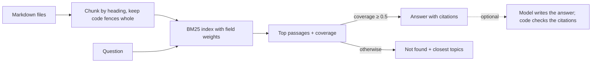

# Docs platform: ask the project questions

All project documentation (`docs/`, ADRs, `README.md`, `CLAUDE.md`, `AGENTS.md`, `REQUIREMENTS.md` and the per-folder
requirements files) is indexed so that a person or an AI assistant can **ask a question and get the passage that answers
it, with its file and line numbers**, instead of searching by hand.

There are three ways in. All use the same knowledge base (`src/lib/docs-kb`).

| You are… | Use | Start it |
|---|---|---|
| A person reading in the browser | The chat screen at `/docs` | `npm run dev`, open <http://localhost:3000/docs> |
| An AI assistant (Claude Code, Cursor, any MCP client) | The MCP server `agora-docs` | already registered for Claude Code by `.mcp.json`; or `npm run mcp:docs` |
| A script or another service | The HTTP API under `/api/docs` | `npm run dev` |

## 1. The chat screen

Open `/docs`, click an example question or type your own. Every answer shows **numbered sources** that link to the document
at the cited line. If the docs do not cover the question the chat says so and lists the closest topics, instead of guessing.

Example (real output of this repository's docs):

> **Q:** (a question about why a safety decision is made by code rather than by a model)
> **A:** the passage from `docs/adr/0005-agents-propose-code-decides.md` that states the decision, `[1]`, followed by
> related passages `[2]`, `[3]` with their paths.

## 2. The MCP server (for AI assistants)

[Model Context Protocol](https://modelcontextprotocol.io) lets an assistant call tools. The server exposes four read-only
tools:

| Tool | Input | Use it to |
|---|---|---|
| `list_docs` | none | See every indexed file with its title and headings. Start here when you do not know what exists. |
| `search_docs` | `query`, optional `limit` | Find passages. Works best with exact terms: requirement ids (`BR-38`, `NEG-OFR-02`), function names (`decideTurn`), topic words. |
| `ask_docs` | `question` | Get a cited answer. Replies `grounded=false` when the docs do not cover the question. |
| `get_doc` | `path`, optional `section` | Read a whole file, or only the passages under a heading, once search has found the right place. |

**Claude Code** picks the server up from `.mcp.json` at the repository root (approve it when asked). To run it by hand or
register it elsewhere:

```bash
npm run mcp:docs
```

```json
{ "mcpServers": { "agora-docs": { "command": "npm", "args": ["run", "--silent", "mcp:docs"] } } }
```

`DOCS_ROOT` points the server at another checkout (default: the current directory). Logs go to stderr; stdout is the protocol.

An assistant's typical session:

```text
list_docs                                   → which files exist
search_docs  { query: "budget breaker" }    → docs/SCALE.md:… › Model gateway…, src/lib/meta/REQUIREMENTS.md:…
get_doc      { path: "docs/SCALE.md", section: "model gateway" }
ask_docs     { question: "What happens when a member's model budget is spent?" }
```

## 3. The HTTP API

All endpoints share the error shape `{ "error": { "code", "message" } }` and the rate limit (120 requests per minute per
address) of the rest of the API.

| Endpoint | Request | Response |
|---|---|---|
| `POST /api/docs/ask` | `{ "question": "…", "k": 4 }` | `{ grounded, mode, answer, citations: [{ n, path, heading, startLine, endLine, excerpt }], related, note? }` |
| `GET /api/docs/search?q=BR-38&limit=6` | query string | `{ hits: [{ path, heading, startLine, endLine, score, text }] }` |
| `GET /api/docs/doc?path=docs/SCALE.md&section=matching` | query string | `{ path, title, markdown }` or `404 not_found` |
| `GET /api/docs/list` | none | `{ docs: [{ path, title, headings, chunks }] }` |

```bash
curl -s localhost:3000/api/docs/ask -H 'content-type: application/json' \
  -d '{"question":"What breaks first at 100 million members?"}'
```

## 4. How it works



1. **Chunking** (`chunk.ts`). Each file is cut at its headings. A passage keeps its heading path, its file title and its exact
   start and end line. Long sections are split at blank lines, never inside a code block, so an example stays whole.
2. **Search** (`search.ts`). BM25 ranking where a match in a heading counts three times, in the title and path twice, and in
   the text once. Identifiers are kept whole (`BR-38`) and also split (`br`, `38`); camelCase is split (`decideTurn` →
   `decide`, `turn`); plurals are folded; question filler ("between", "same") is ignored.
3. **Grounding** (`answer.ts`). The best passage must contain at least half of the question's weight (**coverage**), where a
   rare term weighs more than a common one and a term found nowhere in the docs weighs the most. If it does not, the answer is "I could not find this in the docs." with the closest topics, and no citation. Without a
   model the answer is **extractive**: the best passage, copied, with `[1]` and the other relevant passages listed.
4. **Optional generation.** Pass a `generate` function and a model writes the answer from the numbered sources. The code then
   **checks** it: it must cite at least one source, every cited number must exist, it must not be empty or over-long, and it
   must not be the refusal text. Otherwise the extractive answer is returned and `note` says why. This is the same rule as
   the rest of the platform: a model proposes, code decides (ADR 0005). Source text is passed to the model as untrusted data.

**Why lexical search and not embeddings?** This corpus is full of exact identifiers (requirement ids, function names, file
paths) that embeddings blur and BM25 finds exactly. It needs no model, no network and no vector store, it is deterministic,
and it can be evaluated in CI. A semantic ranker can be added later; the golden set below is how you would know it helped.

## 5. Quality is measured

`evals/docs-qa.golden.json` holds three sets, and `evals/docs-qa.eval.test.ts` runs them on the real documents and fails the
build if quality drops (`npm run evals`). Thresholds are in `evals/thresholds.json` under `docsQa`.

| Set | What it checks | Result (**Measured**, 2026-10-27) | Threshold |
|---|---|---:|---:|
| `answerable` (32 questions) | The right document is cited within the top three passages | **100%** (32/32) | 90% |
| `heldOut` (15 questions) | Same, on questions written after the search was frozen, in different words, never used for tuning | **73%** (11/15) | 70% |
| `unanswerable` (6 questions) | The answer is a refusal with no citation | **100%** (6/6) | 100% |

**Read the held-out number, not the first one.** The first set was used while tuning the search (stemming, how hyphenated words
are handled, question filler), so 100% overstates quality; the held-out set shows the gap (27 points). The held-out misses
were all vocabulary mismatches, which is the limit of lexical search: the question used different words from the
passage that answers it, or a document about this tool outranked the passage. `npm run evals` prints each miss with the
documents it expected and the ones it returned. (The questions themselves are deliberately not quoted here: a document that
repeats a question word for word becomes the best match for that question and would hide the miss.)

The next improvement is a **hybrid ranker**: keep BM25 for identifiers and add embedding similarity for paraphrases, then
re-measure on the held-out set. It is not built; an embedding model would be called through the Meta client. When you
find a question the chat gets wrong, add it to `heldOut` first (so the miss is measured), then fix the search, then move it
to `answerable`.

## 6. Writing docs that retrieve well

The index rewards the same habits that make docs readable:

- **Make headings the question or the topic**: "Why the gatekeeper decides" beats "Notes". Headings weigh three times the text.
- **One idea per section.** A passage is the unit of retrieval and of citation.
- **Use the exact identifier** where one exists (`NEG-OFR-02`, `createMetaClient`, `src/lib/meta/cost-meter.ts`).
- **Put the answer first**, then the reasoning. The excerpt shown in an answer is the start of the passage.
- **Mark status** (Built, Designed, Measured, Assumed), as `docs/SCALE.md` does, so a reader and an assistant can tell
  evidence from intent.
- **Keep examples in code blocks.** Blocks are never split, so a copied example is complete.

Empty files are ignored. Edits are picked up without a restart.

## 7. Limits and security

- **Lexical, English-oriented.** A question that shares no words with the docs (for example, one about "handling a crowd")
  can miss the passage about scaling to millions of members. Use `list_docs` or rephrase. Measured misses are in the golden set.
- **Generation is not run against a real model.** The checking logic is tested with stand-ins; no Meta model has been called.
- **No access control.** Everything indexed is readable by anyone who can reach the endpoint. Do not index anything private,
  and do not expose the endpoints publicly without authentication.
- **Read-only, and only indexed files.** `get_doc` and `/api/docs/doc` resolve only paths found by the indexer, so a request
  such as `../../etc/passwd` returns nothing (covered by `src/lib/docs-kb/docs-kb.test.ts`).
- **Reads files at run time** from the working directory, so the markdown must be present where the server runs.
- **Docs are data.** If a document contains an instruction, it is shown or quoted, never executed.
