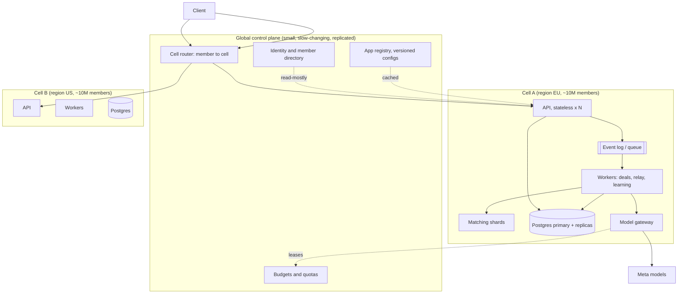

# Scaling Agora to 100 million and 1 billion members

This document says what breaks first as members and apps grow, what to change at each step, whether the change is vertical
or horizontal, and what architecture to use. It is written so a reader (or an AI assistant) can tell what is **evidence**
from what is **reasoning**.

| Label | Meaning |
|---|---|
| **Measured** | Produced by a command in this repo; the command is given. |
| **Built** | Exists in the code today; the file is named. |
| **Designed** | A decision with a reason, not yet implemented. |
| **Assumed** | An input to a calculation. Change it in `evals/capacity-model.ts` and the tables change. |

Nothing beyond one in-memory process is built today. The demo runs in a single Node process with in-memory state
(`CLAUDE.md`, Status). Everything in sections 4 to 8 is therefore a design to adopt in stages, with triggers (section 3) that
say when each stage is worth its cost.

## 1. The short answer

1. **Keep the logic, change the substrate.** The platform is built as slices behind ports (`ModelAdapter`, `MemoryProvider`,
   `CarrierAdapter`, repositories, the `DealEvents` hub). Scaling replaces the in-memory implementation behind each port with
   a distributed one. The domain code (gatekeeper, deal state machine, learning) does not change. *Built: the ports. Designed:
   the distributed adapters.*
2. **Scale out by cells, not by one big cluster.** Everything an owner does is local to a region, a deal and two members, so
   the data splits cleanly. A **cell** is a complete copy of the data plane (API, workers, database, queue, matching index)
   serving a slice of members. Capacity grows by adding cells. A failure or a bad deploy hits one cell.
3. **Scale up only the pieces that are cheap to scale up and hard to split.** One PostgreSQL primary per cell, bigger
   machines for it, until a measured trigger says otherwise (section 3).
4. **At 100 million members and above, the model bill dominates, not the servers.** Servers are a few percent of the
   cost; model calls are most of it (section 2). The architecture's main job is to avoid, batch, cache and route model calls.
5. **Apps scale differently from members.** Today an app is a line in a code registry (`src/lib/app-config/load-app.ts`), so
   adding an app means a deploy. Thousands of apps need a database-backed, versioned, validated app registry and per-app
   quotas (section 6).



## 2. How big is each step? (capacity model)

All inputs are **assumed**; they come from `docs/ARCHITECTURE.md` section 12b (3 deals per member per month, 12 model calls
per deal) plus the assumptions listed under the tables. Reproduce with `npm run capacity`; the figures are pinned by
`evals/capacity-model.test.ts`.

**Traffic**

| Members | Deals / month | Model calls / month | Model calls / s (avg → peak) | API requests / s (avg → peak) |
|---|---:|---:|---:|---:|
| 1,000,000 | 3,000,000 | 36,000,000 | 14 → 139 | 39 → 386 |
| 10,000,000 | 30,000,000 | 360,000,000 | 139 → 1,389 | 386 → 3,858 |
| 100,000,000 | 300,000,000 | 3,600,000,000 | 1,389 → 13,889 | 3,858 → 38,580 |
| 1,000,000,000 | 3,000,000,000 | 36,000,000,000 | 13,889 → 138,889 | 38,580 → 385,802 |

**Model spend per month** (placeholder prices from `src/lib/meta/cost-meter.ts`, which that file marks as unverified)

| Members | All on the large model | 20% large / 80% open | …and 70% fewer calls | Per member per month |
|---|---:|---:|---:|---:|
| 1,000,000 | $67k | $20k | $6k | $0.0061 |
| 10,000,000 | $666k | $202k | $61k | $0.0061 |
| 100,000,000 | $6.7M | $2M | $607k | $0.0061 |
| 1,000,000,000 | $66.6M | $20.2M | $6.1M | $0.0061 |

**Storage and matching memory**

| Members | New stored data / month | Matching index in memory | Matching shards (8 GB each) |
|---|---:|---:|---:|
| 1,000,000 | 66 GB | 780 MB | 1 |
| 10,000,000 | 660 GB | 7.8 GB | 1 |
| 100,000,000 | 6.6 TB | 78 GB | 10 |
| 1,000,000,000 | 66 TB | 780 GB | 98 |

Assumptions behind the tables: peak second is 10× the average; a call is 800 input and 200 output tokens; 20% of calls need
the large model; 70% of calls can be avoided by deterministic code, templates and caches (see 4.5); 100 API requests per member
per month; 22 KB stored per deal; 2 listed items per member; 390 bytes of index per item (measured, section 4.3).

**What the tables say**

- The **same architecture** carries 1× to 1000×: spend per member is constant ($0.0061 in the last column), so cost is
  linear in members. The levers that move it are in 4.5, and they are worth about **11×** between the first and last
  columns ($66.6M → $6.1M at one billion).
- **Peak load is a few hundred thousand requests per second at one billion members.** That is large but ordinary for a
  sharded system, and it is split across cells (100 cells of 10M members each see about 3,900 requests per second at peak).
  The hard part is not the request rate; it is model throughput and cost.
- **Storage grows by tens of terabytes per month at one billion.** Hot data (open deals) is small; most is history, so
  tiering and retention matter more than raw database size (4.2).
- **The matching index fits a handful of machines at 100M and about a hundred at 1B** if sharded (4.3). It does not fit one.

## 3. When to move to the next step (triggers)

Do not build a stage before a trigger fires: every stage adds operating cost and failure modes. These thresholds are rules of
thumb to be replaced by your own measurements; they are **assumed**, not measured here.

| Stage | Members (order of) | Architecture | Move on when |
|---|---:|---|---|
| 0. Demo | < 10k | One process, in-memory (today) | You need persistence or a second user |
| 1. One durable region | 10k – 1M | Stateless API ×2+, one Postgres primary + replica, one queue, auth, outbox | Postgres primary CPU > 60% for a week, or write latency p99 > 50 ms, or one region is not enough for latency or law |
| 2. Horizontal workers | 1M – 10M | Autoscaled API and workers, read replicas, separate matching service, model gateway with queues | Matching p99 > 100 ms in the busiest district, or queue lag > 1 minute at peak, or model spend per member above plan |
| 3. Cells | 10M – 100M | Several independent cells per region, global control plane, event log, sharded Postgres per cell | A single cell's blast radius is unacceptable, or one database cannot take the writes of its members |
| 4. Global scale | 100M – 1B | Many cells across regions, active-active control plane, cost engineering, per-cell operations teams | Mostly organizational: on-call load, release safety, regulation per region |

**Vertical or horizontal?** Vertical scaling is simpler and right until it stops being cheap. Use this as the default rule:

| Component | Scale | Why | Limit that forces the other direction |
|---|---|---|---|
| API servers | Horizontal | Stateless: any instance serves any member | None in practice |
| Workers (deals, relay, learning) | Horizontal, partitioned by deal id | A deal's events must stay ordered; different deals are independent | Hot deals are rare and small |
| PostgreSQL primary | **Vertical first**, then shard by cell | Strong consistency and joins inside a cell are valuable; a large machine goes a long way | Write throughput or storage per cell; then add a cell, not a bigger shard map |
| Read replicas | Horizontal | Dashboards, search, history reads | Replica lag for read-your-writes (route those to the primary) |
| Matching index | **Horizontal by geography** | Items only match nearby; shards align with cells and districts | Dense metros (4.3) |
| Model calls | Horizontal, plus **fewer calls** | The provider rate limit and the bill are the ceiling | Only cost and provider quotas |
| Event log / queue | Horizontal by partition key (deal id) | Ordering per deal, parallelism across deals | Rebalancing cost |
| Identity / app registry | Replicated read-mostly | Small data, read on every request, written rarely | Cross-region write latency (acceptable: rare writes) |

## 4. Component by component

### 4.1 Identity, routing and cells *(Designed)*

Every request must find the member's data without asking every cell. Keep a small **directory** (member id → home cell) that
is cached at the edge and changes only when a member moves.

```ts
// Designed sketch. A cell is chosen once, when the member joins, from their region and the cell's free capacity.
type CellId = `${"eu" | "us" | "apac"}-${number}`;
interface MemberDirectory { cellOf(memberId: string): Promise<CellId>; }
```

Rules that keep cells independent:
- A deal between two members who live in **different cells** is owned by the cell of the member who started it; the other
  cell holds a reference and receives events through the log. Cross-cell deals are the exception because exchange is local,
  but the design must allow them. *Reasoning, not measured: the sandbox city is single-district.*
- Nothing in a cell may call another cell synchronously on the request path.
- Keys and secrets are per cell (envelope encryption with a per-cell key), so a leak is contained. Today a single
  `FIELD_ENCRYPTION_SECRET` is used (`src/lib/env.ts`, `src/lib/crypto.ts`); per-cell keys and a KMS are *Designed*.

### 4.2 Data: what to store where, and for how long *(Designed; schema Built)*

The schema already follows the rule that scales: **each slice owns its tables**, tables are prefixed by slice and joined only
inside a slice (`db/migrations/0001`–`0010`). That makes the cut points mechanical.

| Data | Today | At scale | Partition key | Retention |
|---|---|---|---|---|
| Members, consent, limits | in-memory | Postgres, per cell | member id | until erased |
| Items (offers, wants) | in-memory | Postgres + matching index | member id; index by district | not set in `docs/PRIVACY.md`; proposal: while listed |
| Deals and offers | in-memory | Postgres, row per deal with a `version` | deal id | not set in `docs/PRIVACY.md`; proposal: 12 months, then cold storage |
| Relay messages | in-memory | Postgres, **time-partitioned**, screened text and hash only | deal id + month | deal end + 30 days (proposed in `docs/PRIVACY.md`) |
| Audit | counters in memory | append-only table, time-partitioned; cold storage after 12 months | month | 12 months (decided); erasure unlinks (BR-36) |
| Model call records | in the cost meter | append-only metrics store | day | 90 days (decided, as metrics); **counts only** (ADR 0006) |
| Handoff places and addresses | in-memory, AES-256-GCM | Postgres, encrypted per cell key | deal id | handoff end + 30 days (proposed in `docs/PRIVACY.md`) |

Example of the one change that matters most, time partitioning of the append-only tables:

```sql
-- Designed sketch: relay messages partitioned by month so old data moves to cheap storage without a table rewrite.
CREATE TABLE relay_messages (
  id uuid NOT NULL, negotiation_id uuid NOT NULL, created_at timestamptz NOT NULL,
  from_family_id uuid NOT NULL, to_family_id uuid NOT NULL, text_relayed text NOT NULL, text_hash bytea NOT NULL,
  PRIMARY KEY (negotiation_id, created_at, id)
) PARTITION BY RANGE (created_at);
```

Hot data stays small: open deals are a tiny fraction of stored rows, so the working set fits memory long after total storage
reaches terabytes. **Check this with a real workload before relying on it.**

### 4.3 Matching: measured, with one known weakness *(Built; measured)*

The index (`src/features/matching/features/candidates/internal/infrastructure/candidate-index.ts`) buckets listed items by
app, kind, category and district cell (0.05° ≈ 5.6 km). A lookup visits the nearby cells and scores what it finds. That
avoids scanning all items, but the cost of a lookup is **proportional to the number of items in the nearby buckets**.

Measured with `npm run bench:matching -- --items N` (Apple M3 Pro, Node, one thread, in-memory, no model calls, 2,000 lookups).
"spread": items over a wide area. "metro": 80% of items inside one city of about 15 × 15 km.

| Items | World | Build | Heap | p50 | p99 | max |
|---:|---|---:|---:|---:|---:|---:|
| 100,000 | spread | 260 ms | 68 MB | 0.18 ms | 5.8 ms | 17.8 ms |
| 100,000 | metro | 271 ms | 45 MB | 12.6 ms | 71.3 ms | 187 ms |
| 1,000,000 | spread | 2.4 s | 389 MB | 0.60 ms | 1.4 ms | 44.7 ms |
| 1,000,000 | metro | 1.8 s | 350 MB | 130 ms | 751 ms | 1,299 ms |

What this shows:
1. **Spread-out data is fast, and at 1,000,000 items memory is about 0.35–0.39 KB per item** (the figure used in section 2; the
   100,000-item rows include allocator warm-up, so they read higher per item).
2. **A dense city is the real scaling problem.** With 1,000,000 items and 80% in one metro, a typical lookup takes 130 ms and
   the slow tail passes 0.7 s, because a few buckets hold most items and every lookup scores all of them. Memory is fine;
   latency is not. Members, not machines, are the bottleneck here: a big city's members share the same buckets.
3. Therefore the earlier statement "an incremental lookup of top-K candidates" is true of the *result* (three matches are
   returned) but not of the *work* (the nearby buckets are scanned).

Fixes, in the order to try them (**Designed; none measured yet**; each is cheap to test with the benchmark above):
1. **Smaller buckets where the data is dense.** Choose the cell size from the local density instead of a constant 0.05°
   (an adaptive quadtree, or H3 resolution by density). A 10× smaller cell cuts the scanned items by roughly 10×.
2. **Add size band to the bucket key** for categories where size is a hard filter (clothing, shoes). It removes
   mismatched sizes before scoring. Keep it out of the key where size is optional.
3. **Cap and rank cheaply.** Score at most N candidates, chosen by a cheap pre-score (distance and recency), and stop. Report
   the cap in the result so ranking stays honest.
4. **Move the work to write time.** When an item is listed, compute and store the top-K counterparts incrementally, so a
   lookup is a key read. This makes listing more expensive and lookups constant; it is the right end state for metros.
5. **Shard by cell and district range** across machines (about 10 shards at 100M members, 98 at 1B, section 2). Sharding
   adds memory, not speed, for one hot district; fixes 1–4 are what make a metro fast.

### 4.4 Deals, events and ordering *(Built in-process; Designed distributed)*

Today the `DealEvents` hub is an in-process bus and stores are synchronous (`src/hubs/DealEvents`). The domain rules are
already what a distributed system needs:
- the deal state machine is a **pure function** `next(deal, event, time)` and every transition is recorded, so deals can be
  replayed;
- cross-slice effects go **only through events** (`DealAgreedByAgents`, `DealConfirmed`, …), never direct calls.

To distribute it:
1. Persist the deal row with an integer `version` and update with `WHERE version = $expected` (optimistic concurrency).
2. Write the event to an **outbox table in the same transaction** as the state change, and publish it from there. This is
   what turns "the database changed and the event got lost" into an impossible state.
3. Partition the event log by **deal id**. Per-deal order is preserved; deals run in parallel.
4. Make consumers **idempotent** with a processed-event table, because the log delivers at least once.

```ts
// Designed sketch of an idempotent consumer. The shape of the handler is unchanged from today's bus subscribers.
async function handle(e: DealEvent, db: Tx) {
  const first = await db.insert("processed_events", { consumer: "owner-cards", eventId: e.id }).onConflictDoNothing();
  if (!first) return; // already handled
  await ownerCards.onDealEvent(e);
}
```

Timers (the 24-hour deal expiry, which `docs/ARCHITECTURE.md` section 5 notes is not yet wired) become a scan on an index of
`(state, expires_at)` run per cell, not a timer per deal. A billion open timers are a data problem, not a scheduler problem.

### 4.5 The model gateway and cost *(Built: client, router, meter; Designed: distribution)*

`createMetaClient` (`src/lib/meta/client.ts`) already does what a gateway needs: one entry point, role-based routing, schema
validated output with one retry, and a cost meter that checks budgets **before** a call. What changes at scale:

| Lever | What it does | Effect (illustration from section 2) |
|---|---|---|
| Route cheap roles to the open model | `router.ts` is table driven; most roles do not need the large model | all-large $6.7M → 20/80 mix $2M per month at 100M members |
| Avoid the call | Deterministic code decides first; templates replace generated notes; translations are cached per text and language pair (`language` slice) | a further 70% fewer calls → $607k per month |
| Cache with a content hash | Identical text and language pair gives an identical translation; cache hit rate decides the saving | not measured; track the rate as a metric |
| Batch and coalesce | Send several short translations in one request; merge identical in-flight requests | shifts cost from per-call overhead to tokens; not measured |
| Smaller specialised models | Distil the large model's outputs for stable tasks (topic labels, short translations) | not measured; needs an eval gate (`evals/`) before switching |
| Backpressure and priorities | Owner-facing steps first; background learning last; shed or delay when the queue is long | protects latency, not cost |
| Degrade to deterministic | When the budget or provider is out, `BudgetExceededError` already tells callers to fall back | built in `src/lib/meta/cost-meter.ts` |

**Budgets without a single bottleneck.** `CostMeter` keeps totals in one process. Distributed, a central counter on every call
is a bottleneck and a single point of failure. Use **leases**: the control plane hands each cell (and each app within it) a
slice of the budget; the cell spends it locally and asks for more when low. The worst case is bounded by the sum of leases,
so the global breaker still holds, at the cost of a little unused budget. *Designed.*

**Provider rate limits.** At 100M members the peak is about 13,900 model calls per second (section 2). That needs a committed
quota with the provider, several regions and a fallback model. Treat the provider as a dependency with an error budget, not
as infinite capacity. *No quota has been confirmed with a provider.*

### 4.6 Relay, notifications and fan-out *(Built rules; Designed delivery)*

The rule that keeps fan-out bounded is already a requirement (NFR-09): **never one model call per member per post**. A
community post is filtered by a cheap deterministic prefilter, then scored once per post and cached against member-interest
vectors, with per-member and per-community post caps. At scale:
- Deliver by **pull with a precomputed feed** for large communities and by push for 1:1 deals.
- Keep the receiving-side relevance gate (it is what protects members from noise) and make it cheap: deterministic first,
  one cached similarity second.
- Rate limits are per member and per community, enforced in the cell that owns them.

### 4.7 Rate limiting and abuse *(Built per process; Designed distributed)*

`src/lib/rate-limit.ts` is a sliding window in one process. (An audit of it found and fixed unbounded memory growth: idle
keys were never removed; see `src/lib/rate-limit.test.ts`.) At scale: a token bucket per member and per IP at the edge, with
counters in a fast shared store and a small local allowance so a store outage degrades to "slightly too permissive for a few
seconds", not to an outage. At a billion members, **fake accounts** are the main abuse, so trust scores (`trust` slice) and
account friction (verification) carry more weight than raw rate limits.

### 4.8 Reliability *(Designed)*

- **Bulkheads.** One queue and one worker pool per concern (negotiation, relay, learning, carrier) so a stuck carrier cannot
  starve deals.
- **Kill switches per feature** (shipping, voice, learning, relay screening level) in a flag service. The docs list env flags
  as built, but `src/lib/flags.ts` was an empty placeholder and has been removed; flags are **not built**.
- **Degraded modes** that keep the safety rules: model unavailable → deterministic templates and "ask the owner"; queue
  lag → delay learning and digests first; database read-only → serve cached views, refuse writes with a clear message.
  Safety never degrades: the gatekeeper is code and has no external dependency (ADR 0005).
- **SLOs** per cell, for example: owner card visible within 5 s of the event (99%), relay message delivered within 10 s
  (99%), API availability 99.9%. Error budgets decide whether a release ships.
- **Releases** by cell: deploy to one small cell, watch the SLOs, then widen.

### 4.9 Security and privacy at scale

The privacy rules are properties of the data model and survive scaling because they are enforced in code and tests
(`src/app/api/invariants.test.ts`): coarse location until both owners confirm, no message text in logs, originals discarded.
Scale adds: per-cell keys and a KMS; regional residency (a member's data stays in the cell's region); row-level security keyed
by member inside each database; and an external security review before real users (`docs/SECURITY.md`).

### 4.10 Observability and operations *(Designed)*

Per cell, with a request id on every log line and no personal data: request rate and latency by route, queue lag by queue,
model calls, tokens, spend, cache hit rate and error rate **by role and by app**, matching latency by district density, and the
product metrics the simulation already defines (confirmed deals per 100 wants, owner cards per confirmed deal). The cost
panel in the judge dashboard is not built.

## 5. Worked examples

**A. A member lists a winter jacket, at 100M members.** The edge looks up the member's cell → the API validates and writes the
item and an outbox row in one transaction → the event reaches the matching shard for that district → the shard indexes the
item and, for each nearby want, computes top-K incrementally (4.3 fix 4) → matches become owner cards through the same
`DealEvents` flow as today. Model calls on this path: zero; matching and the gatekeeper are deterministic.

**B. A running-club app with 5 million members goes viral in 48 hours.** What breaks, in order: (1) its posts flood the
relevance scorer, so per-app and per-community post caps and the cached one-similarity-per-post rule (4.6) bound the load;
(2) its model spend grows, so its per-app budget lease (4.5) caps it and falls back to deterministic scoring, other apps
unaffected; (3) its workers back up, so it moves from the shared pool to a dedicated pool (tenancy tier "bridge", section 6).
No code change; configuration and capacity.

**C. A budget incident.** A bug makes an agent loop. The per-participant budget stops that member after $0.50
(`DEFAULT_BUDGET` in `src/lib/meta/client.ts`), the cell's lease stops the cell at its slice, the global breaker stops all
spend at its cap. `BudgetExceededError` makes callers fall back to deterministic behaviour, so owners see slower, plainer
answers, not errors.

## 6. Scaling the number of apps

Members multiply the load; **apps multiply the variety**. The design goal in ADR 0002 is that a generated app can only break
itself. To run thousands of apps, make that true at runtime too.

**What exists (Built).**
- An app is `apps/<id>/app.config.ts`, validated by a zod schema that refuses configs relaxing the safety rules
  (`src/lib/app-config/schema.ts`, tested in `app-config.test.ts`).
- The matching index keys include the app id, so apps cannot see each other's items.
- Lint prevents platform code from importing an app and apps from importing the platform, except the config API.

**What blocks scale (Built, and limiting).** Apps are registered in a hard-coded map in `src/lib/app-config/load-app.ts`
("the only place platform code reaches into `apps/`"). Each new app is a code change and a deploy, and every app is loaded
into the same process.

**What to change (Designed).**

| Need | Change | Why it scales |
|---|---|---|
| Add an app without a deploy | An **app registry table**: `apps(app_id, version, config jsonb, status, created_by, created_at)`; configs are immutable versions | Adding an app is an insert, validated by the same zod schema |
| Safe generation by Muse | Validate on write, then run the app's **sandbox community** and the safety evals before it can go live; a human reviews the first publish | The schema and evals already exist; they become a publishing gate |
| Roll out a config change | Versioned configs with canary: a small share of members on version N+1, automatic rollback on SLO breach | An app change is as safe as a code release |
| Fair sharing | Per-app **quotas** (requests, model spend, storage, posts per minute) and per-app queues | One viral app cannot starve the others |
| Cost attribution | Tag every model call and stored row with the app id | Needed to bill or throttle by app |
| Different needs | **Tenancy tiers**: pooled (default), bridge (dedicated worker pool and queue), silo (dedicated cell) | Big or regulated apps pay for isolation; small apps stay cheap |

```sql
-- Designed sketch: configs are immutable versions; members run one version, so a bad change is a rollback, not a hotfix.
CREATE TABLE app_versions (
  app_id text NOT NULL, version int NOT NULL, config jsonb NOT NULL, status text NOT NULL CHECK (status IN ('draft','canary','live','retired')),
  created_by text NOT NULL, created_at timestamptz NOT NULL DEFAULT now(), PRIMARY KEY (app_id, version)
);
```

## 7. Migration path from today's code

Each step is shippable on its own and reuses a test that already exists. Order matters: durability first, distribution later.

| # | Step | Reuses (Built) | Done when |
|---|---|---|---|
| 1 | Postgres repositories behind the existing repository ports (deals, items, lessons, handoffs) | The in-memory repositories and migrations 0001–0010; the shared contract suites for ports | The contract suites pass against Postgres and in-memory |
| 2 | Authentication and per-request authorization (replace the two demo personas) | `route()` in `src/app/_composition/api.ts`, ownership checks in slices | Every route rejects a request for another member's card or deal |
| 3 | Outbox + durable event log behind `DealEvents` | The hub API and idempotent handler shape | Kill the process mid-deal and the deal resumes without duplicate cards |
| 4 | Distributed rate limiting and budgets (leases) | `rate-limit.ts`, `CostMeter` | A second instance shares limits and the global breaker still holds |
| 5 | Matching service with density-aware buckets | `npm run bench:matching` as the acceptance test | metro p99 under 100 ms at 1M items |
| 6 | Model gateway: cache, batch, priorities, provider fallback | `createMetaClient`, router, schema validation | Cost per deal and cache hit rate on a dashboard; a provider outage degrades, does not fail |
| 7 | App registry in the database with versions and quotas | The zod schema, sandbox community, red-team evals | An app can be published, canaried and rolled back without a deploy |
| 8 | Cells: directory, per-cell keys, regional data residency | Slice boundaries; app and member ids in every key | Two cells run side by side; killing one leaves the other serving |

Steps 1–3 carry the product to millions. Steps 4–6 control cost and latency. Steps 7–8 are what 100 million and a
thousand apps need.

## 8. What not to do

- **Do not split into microservices early.** The slice boundaries are already enforced by lint (ADR 0001); extract a slice only
  when a trigger in section 3 says its load or team needs it. Extraction order: model-heavy workers, then media, then logistics.
- **Do not use one global database.** It is a single failure domain and a cross-region latency tax on every write.
- **Do not make safety depend on a service.** The gatekeeper stays in-process code (ADR 0005); an outage elsewhere must never
  turn "ask the owner" into "go ahead".
- **Do not fan out per member.** One model call per member per post cannot be paid for at any size (NFR-09).
- **Do not trust unmeasured numbers.** Section 2 is a model of assumptions and section 4.3 is one machine's benchmark. Re-run
  both against real traffic before committing to hardware or a contract.

## 9. What is still unknown

- The real price and quota of the Meta models (the open-model price is a placeholder), and the real call count per deal.
- Real usage: deals per member, active listings per member, and how concentrated members are in large cities.
- Whether cross-cell deals are rare enough to treat as an exception.
- How much of the call volume a cache can absorb: it depends on how repetitive real messages are.

Reproduce the evidence: `npm run capacity`, `npm run bench:matching -- --items 1000000`, `npm run simulate`, `npm test`.
